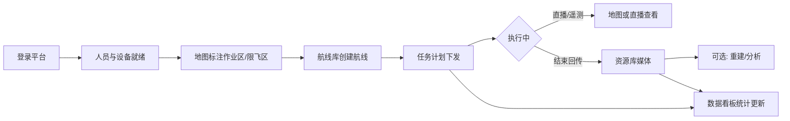

# 产品需求文档（PRD）— 单项目无人机云端作业平台

| 文档版本 | 修改日期 | 修改人 | 修改内容 |
|----------|----------|--------|----------|
| V0.1 | 2026-07-21 | Auto | 基于司空平台截图与公开能力梳理初稿（单项目、无多项目概念） |

> **定稿状态**：待确认。确认后方可进入原型图（`tkxm-prototype`）。  
> **输入依据**：`D:\AiFlow` 下司空界面截图（数据看板 / 地图标注 / 航线库 / 任务计划 / 资源库 / 人员管理 / 设备管理）及司空 2 公开能力说明。  
> **产品裁剪原则**：平台本身即唯一作业空间，**不提供「项目」创建、切换、列表与项目级隔离**；原「项目内」能力全部提升为平台级能力。

---

## 1. 产品背景和目标

### 1.1 背景

行业无人机作业已从「单机飞控」走向「云端协同」：需要远程看地图与直播、规划航线与任务、管理机场/飞行器、沉淀媒体与模型，并逐步引入 AI 检测与自动化工作流。司空类产品提供了成熟参考，但多项目组织模型对「固定场地、单一作业主体」场景偏重。

### 1.2 目标

打造一套 **单作业空间** 的 Web 云端作业平台（下称「本平台」），支持：

1. 一屏掌握资产、任务与飞行数据（数据看板）  
2. 在地图上完成标注、限飞/作业区与协同（地图作业）  
3. 管理航线、下发任务计划并跟踪执行（航线与任务）  
4. 管理媒体/模型等成果，并支持重建与变化检测等分析（资源与成果）  
5. 管理人员、角色与设备全生命周期（人员与设备）  
6. 为后续算法与开放能力预留入口（算法管理）

### 1.3 成功标准（初稿）

- 管理员可在无「项目」概念下完成：加人 → 绑设备 → 画作业区 → 建航线 → 建计划 → 看媒体/看板  
- 关键作业链路（计划执行状态、媒体回传、设备在线状态）在看板或对应模块可追溯  
- 界面与信息架构清晰，单作业空间心智一致（无项目切换）

---

## 2. 产品范围

### 2.1 本期包含（P0/P1）

| 优先级 | 范围 |
|--------|------|
| P0 | 登录与账号；数据看板（核心指标 + 地图概览）；地图与标注；航线库；任务计划；资源库（媒体）；人员与角色；设备管理（机场/飞行器） |
| P1 | 资源库（模型/设计文件/回收站）；模型重建入口；直播录制回放目录；设备绑定码与定损反馈；看板自动化/任务图表；固件与飞行安全库字段展示 |
| P2（可本期占位） | 智能搜索、变化检测 Pro、超清全景、多模态识别、算法管理完整能力、工作流编排 |

### 2.2 本期不包含

| 排除项 | 理由 |
|--------|------|
| 多组织 / 多项目 / 项目邀请码 / 项目归档 | 产品明确为单作业空间 |
| 跨项目资源迁移、项目级权限矩阵 | 无项目概念后统一为平台角色权限 |
| 私有化部署完整方案、OpenAPI 正式对外开放 | 可作为后续规划，本期不写死接口对外 SLA |
| Pilot 端完整交互规格 | 本期以 Web 为主；与现场端同步仅描述「设备同步」能力边界 |
| 完整 AI Agent / 大模型对话编排 | 截图有入口与指标，细节待算法管理专项 |

### 2.3 后续规划

- 算法管理：检测模型上架、告警规则、与直播/回放联动  
- 自动化工作流：采集 → 重建 → 分析 → 报告拖拽编排  
- 开放能力：OpenAPI / 数据同步 / PaaS 嵌入（航线、驾驶舱、设备、回放）  
- 与机场无人值守深度运维（远程调试细则、维保工单闭环）

---

## 3. 用户故事与用例

### 3.1 用户角色

| 角色 | 描述与核心诉求 |
|------|----------------|
| **超级管理员** | 平台最高权限；管理人、设备、角色；可操作全部业务模块 |
| **管理员** | 日常运维负责人；配置标注/航线/任务；查看看板与成果 |
| **设备维护员** | 关注机场/飞行器绑定、固件、告警、定损反馈 |
| **作业员** | 查看地图与任务、使用航线与媒体；权限受限的编辑能力 |
| **只读观察者**（可选） | 仅看板与成果查看，不可改配置 |

> 说明：角色名可与司空对齐调整；本期至少落地「超级管理员 + 管理员 + 作业员」三档。

### 3.2 用户故事

1. 作为管理员，我希望打开数据看板一眼看到设备、任务与飞行统计，以便判断今日能否正常作业。  
2. 作为管理员，我希望在地图上绘制作业区与限飞区并同步到设备端，以便现场与云端规则一致。  
3. 作为作业员，我希望在航线库创建/编辑巡检航线，以便复用固定巡检路径。  
4. 作为管理员，我希望创建立即/定时/循环任务计划并选择航线与设备，以便机场自动执行。  
5. 作为作业员，我希望在资源库按巡检批次查看照片与直播回放，以便复盘与取证。  
6. 作为超级管理员，我希望添加人员并分配角色，以便控制谁能改设备与任务。  
7. 作为设备维护员，我希望用绑定码绑定机场并查看固件/工作状态，以便保障机队可用。

---

## 4. 业务流程

### 4.1 核心业务流程图

### 4.2 任务计划状态流转

| 当前状态 | 触发动作 | 目标状态 | 权限校验 |
|----------|----------|----------|----------|
| 草稿（可选） | 确认创建 | 待执行 | 管理员及以上 |
| 待执行 | 到达计划时间 / 立即执行 | 执行中 | 系统或管理员 |
| 待执行 | 暂停 | 已暂停 | 管理员及以上 |
| 已暂停 | 恢复 | 待执行 | 管理员及以上 |
| 执行中 | 执行成功 | 已完成 | 系统 |
| 执行中 | 失败 / 超时 | 失败 | 系统 |
| 执行中 | 人工结束 | 已结束 | 管理员及以上 |
| 部分完成 | 断点续飞 | 待执行（续飞任务） | 管理员及以上 |

### 4.3 设备在线状态（示意）

| 当前状态 | 触发 | 目标状态 |
|----------|------|----------|
| 离线 | 心跳恢复 | 在线（空闲/作业中/调试中等） |
| 在线空闲 | 开始任务 | 作业中 |
| 作业中 | 任务结束 | 空闲 |
| 任意 | 超时无心跳 | 离线 |

---

## 5. 功能需求

### 5.1 功能模块总览

| 编号 | 模块 | 说明 | 优先级 |
|------|------|------|--------|
| M1 | 账号与权限 | 登录、角色、人员 CRUD | P0 |
| M2 | 数据看板 | 资产/成果/自动化/任务/飞行数据 + 地图概览 | P0 |
| M3 | 地图作业 | 标注、作业区、限飞区、量测、设备同步 | P0 |
| M4 | 航线库 | 航线 CRUD、机型筛选、导入导出 | P0 |
| M5 | 任务计划 | 计划创建、策略、安全参数、状态管理 | P0 |
| M6 | 资源库 | 媒体/模型/设计文件/回收站；分析入口 | P0/P1 |
| M7 | 设备管理 | 机场、飞行器、绑定、固件与状态 | P0 |
| M8 | 算法管理 | 算法列表与配置（本期可占位） | P2 |
| M9 | 数据管理 | 组织级数据视图（与资源库边界见下） | P1 |

> **与司空差异**：取消「项目」模块；顶栏「项目」入口改为直接进入地图作业或作为「作业台」首页。原项目成员/设备归属改为平台归属。

### 5.2 功能详情

#### 5.2.1 F-M1 账号与人员

- **[P0] 登录**：支持账号密码登录；登录后进入数据看板或作业台。  
  验收标准：错误密码有明确提示；成功进入已登录态页面。

- **[P0] 添加人员**：支持单个添加；记录账号、名称、角色、加入方式、加入时间。  
  验收标准：超级管理员可添加；列表可按角色筛选与关键词搜索。

- **[P0] 角色管理**：至少配置超级管理员 / 管理员 / 作业员权限集（模块可见 + 写操作）。  
  验收标准：作业员无法进入角色管理；无法删除超级管理员（或仅转移后可删）。

- **[P1] 编辑/删除人员**：支持编辑角色与删除（需二次确认）。  
  验收标准：删除后无法登录；操作写审计日志（若本期做审计）。

#### 5.2.2 F-M2 数据看板

- **[P0] 资产概览**：展示存储空间、建图数量、直播时长用量；机场状态分布（空闲/作业/调试/离线）；飞行器数、中继站数、人员数、航线数、AI 算法数。  
  验收标准：无数据时显示 0 或空态，不报错；有数据时与后台一致。

- **[P0] 数据成果**：媒体数、模型数、报告数、AI 目标告警数（可先接媒体/模型真实数，报告/告警可占位）。  
  验收标准：点击可跳转资源库对应分类（若已实现）。

- **[P1] 自动化与任务图表**：工作流数量、执行循环次数、成功率；任务分布（计划/手动）；执行结果（成功/暂停/失败）。  
  验收标准：支持本周/本月/上周/上月/近半年/近一年/自定义时间筛选。

- **[P0] 飞行数据**：飞行架次、飞行时长、飞行里程。  
  验收标准：随时间筛选变化；无任务时为 0。

- **[P0] 中央地图**：展示作业空间地图；支持缩放、2D/3D、指南针；底栏显示比例尺与坐标系信息（如 WGS84、ASL/HAE）。  
  验收标准：地图可加载；无设备时仍可浏览底图。

#### 5.2.3 F-M3 地图作业

- **[P0] 标注图层**：支持点/线/面；列表管理作业区、限飞区等；支持显示/隐藏。  
  验收标准：新建标注后地图与列表同时可见；可删除/重命名。

- **[P0] 量测工具**：距离、面积量测。  
  验收标准：量测结果有数值展示。

- **[P1] 高程/2.5D、航线快捷、安全相关 Tab**：与截图左侧 Tab 对齐，可分迭代。  
  验收标准：未实现 Tab 不展示或展示「即将推出」。

- **[P0] 设备同步**：将云端标注/区域规则同步到关联设备端。  
  验收标准：有同步入口与成功/失败反馈；无设备时提示先绑定设备。

#### 5.2.4 F-M4 航线库

- **[P0] 航线列表**：文件夹组织；按机型筛选；按时间排序；显示更新时间。  
  验收标准：空库有引导创建；支持搜索（P1）。

- **[P0] 创建/编辑航线**：支持常见类型（航点巡检、二维网状、斜面、几何体精细等——本期可先做航点 + 一种面状，其余类型可扩展）。  
  验收标准：保存后列表可见；编辑后更新时间变化。

- **[P1] 导入/导出**：支持 KMZ/行业约定格式导入导出与下载。  
  验收标准：非法文件有错误提示；合法文件可进入编辑器。

#### 5.2.5 F-M5 任务计划

- **[P0] 新建计划**：计划名称；任务类型（普通任务 / 航线任务 / 手动飞行任务）；选择航线与设备。  
  验收标准：必填项未填无法提交；提交后进入待执行或立即执行中。

- **[P0] 执行策略**：立即 / 单次定时 / 循环定时 / 连续执行。  
  验收标准：定时未到点不执行；循环按规则生成后续执行记录。

- **[P0] 安全与作业参数**：任务精度（RTK / GNSS）；断点续飞开关；智能返航规划开关；相对起飞点最低飞行高度；失联动作（返航 / 继续执行）。  
  验收标准：参数写入计划详情并可回看。

- **[P1] 多模态识别开关**：与算法能力联动；无算法时开关禁用并提示。  
  验收标准：禁用态不可开启。

- **[P0] 计划管理**：查看状态；暂停/恢复/删除/复制（按状态限制）。  
  验收标准：执行中删除需限制或二次确认；状态与 4.2 一致。

#### 5.2.6 F-M6 资源库

- **[P0] 媒体管理**：照片/视频/压缩文件分类；文件夹（如巡检批次、直播录制回放、全景图）；列表字段含名称、标签、拍摄负载、大小、创建时间；下载/分享入口（分享可 P1）。  
  验收标准：可创建文件夹、导入文件；存储占用与剩余空间展示正确。

- **[P1] 模型 / 设计文件 / 回收站**：分类存储与恢复删除。  
  验收标准：删除进回收站；回收站可还原或彻底删除。

- **[P1] 模型重建入口**：从媒体发起重建任务（异步）。  
  验收标准：有任务状态；完成后模型数或模型列表更新。

- **[P2] 智能搜索、变化检测 Pro、超清全景**：界面可先保留入口，能力可后置。  
  验收标准：未开通时有明确不可用说明。

#### 5.2.7 F-M7 设备管理

- **[P0] 设备分类 Tab**：机场/地面站、飞行器、其它物流设备。  
  验收标准：切换 Tab 列表隔离正确。

- **[P0] 设备列表字段**：型号、SN、名称、固件版本、固件升级、飞行安全数据库、工作状态、加入组织时间、在线时间、操作。  
  验收标准：无设备显示空态；支持按 SN/名称搜索。

- **[P0] 设备绑定码**：生成/查看绑定码，用于现场绑定机场或飞行器。  
  验收标准：有绑定码展示与「如何绑定」说明入口。

- **[P1] 设备定损与反馈**：问题报告入口。  
  验收标准：可提交描述并生成可追踪记录。

#### 5.2.8 F-M8 算法管理（占位）

- **[P2] 算法列表**：展示已接入算法数量与状态；与看板「AI 算法数」「AI 目标告警」对齐。  
  验收标准：无算法时为空态；不阻塞 P0 主流程。

#### 5.2.9 F-M9 数据管理

- **[P1] 数据管理入口**：与资源库的关系二选一（实现时定稿）：  
  - **方案 A**：数据管理 = 资源库的组织视图（推荐，避免双入口）  
  - **方案 B**：数据管理偏报表/导出/用量明细，资源库偏文件作业  
  验收标准：顶栏不出现重复且让人困惑的两个「文件库」。

---

## 6. 界面交互说明

### 6.1 页面清单

| 页面 | 访问路径（示意） | 对应功能 |
|------|------------------|----------|
| 登录页 | `/login` | M1 |
| 数据看板 | `/dashboard` | M2 |
| 地图作业 | `/map` | M3 |
| 航线库 | `/waylines` | M4 |
| 任务计划 | `/missions` 或地图侧「新建计划」 | M5 |
| 资源库 | `/library` | M6 |
| 人员管理 | `/members` | M1 |
| 设备管理 | `/devices` | M7 |
| 算法管理 | `/algorithms` | M8 |
| 数据管理 | `/data` 或重定向资源库 | M9 |

### 6.2 信息架构（单项目裁剪后）

**顶栏**：数据看板｜作业台（地图）｜人员管理｜设备管理｜数据管理｜算法管理  

**作业台左侧图标栏**（原项目内导航提升为平台级）：地图标注｜航线库｜资源库｜（直播）｜任务记录｜成员快捷｜设备快捷｜设置  

### 6.3 关键交互规则

1. **无项目选择器**：任何页面不得出现「切换项目」「创建项目」。  
2. **空态**：列表无数据时给出主操作按钮（如添加人员、绑定设备、新建航线）。  
3. **危险操作**：删除人员/设备解绑/删除航线/删除计划需二次确认。  
4. **权限**：无权限模块菜单隐藏或点击提示无权限。  
5. **地图**：标注工具与列表联动；选中列表项地图定位居中。  
6. **任务创建抽屉/侧栏**：与截图一致的表单分区（任务详情 → 航线设备 → 识别与精度 → 策略 → 安全参数 → 取消/确定）。

---

## 7. 非功能需求

### 7.1 性能

- 看板首屏关键指标接口 P95 &lt; 2s（内网或同等条件）  
- 地图平移缩放流畅；同时展示标注数量建议有分层/聚合策略（上限可后续定）  
- 媒体列表分页默认 50 条/页

### 7.2 安全

- 登录鉴权；会话超时退出  
- 按角色鉴权到模块与写操作  
- 绑定码具备有效期或刷新机制（建议）  
- 敏感操作审计（建议 P1）

### 7.3 可用性

- 关键写操作失败可重试并保留表单  
- 任务/重建等异步任务有状态可查

### 7.4 兼容性

- 浏览器：Chrome 最新两个大版本（主）；Safari / Edge 可用  
- 地图坐标系默认 WGS84；高度展示 ASL/HAE 需标注含义  
- 航线文件：优先兼容行业常见 KMZ（wpml）结构

### 7.5 可维护性

- 前后端错误码与用户可读文案分离  
- 关键链路日志：登录、绑设备、下发任务、媒体上传

---

## 8. 数据需求

### 8.1 数据实体概览

#### 8.1.1 用户（User）

账号、显示名、角色、状态、加入时间、加入方式。

#### 8.1.2 角色与权限（Role / Permission）

角色编码、权限点列表（模块 + 动作）。

#### 8.1.3 设备（Device）

类型（机场/飞行器/其它）、型号、SN、名称、固件版本、工作状态、在线时间、绑定时间。

#### 8.1.4 地图标注（Annotation）

类型（点/线/面）、名称、几何、样式、是否限飞/作业区、同步状态。

#### 8.1.5 航线（Wayline）

名称、机型、航线类型、文件/结构化参数、更新时间、文件夹。

#### 8.1.6 任务计划（MissionPlan）

名称、类型、关联航线、关联设备、策略、精度、安全参数、状态、计划/实际时间。

#### 8.1.7 媒体资源（MediaAsset）

名称、类型、标签、负载、大小、路径、创建时间、文件夹、来源（上传/直播录制/任务回传）。

#### 8.1.8 模型与重建任务（Model / ReconstructJob）

模型类型、状态、来源媒体、完成时间。

#### 8.1.9 用量与统计（Quota / FlightStat）

存储配额与已用、直播时长、建图张数；架次/时长/里程聚合。

### 8.2 数据约束

- 设备 SN 在平台内唯一  
- 单平台无多租户项目隔离；若未来多租户以「组织/租户」另议，不等于「项目」  
- 删除航线前需检查是否被「待执行/执行中」计划引用  
- 预估：媒体为主数据量；需对象存储与生命周期策略（后续）

---

## 9. 验收标准

| 编号 | 验收项 | 预期结果 | 优先级 |
|------|--------|----------|--------|
| A1 | 无项目概念 | 全站无创建/切换项目入口 | P0 |
| A2 | 主路径闭环 | 加人→绑设备→标注→航线→计划→媒体/看板可走通 | P0 |
| A3 | 看板 | 指标与时间筛选可用；空数据不崩溃 | P0 |
| A4 | 地图 | 作业区/限飞区可创建并列表展示；可同步（有设备时） | P0 |
| A5 | 航线 | 至少一种航线可创建编辑保存 | P0 |
| A6 | 任务 | 立即与定时策略可用；状态流转符合 4.2 | P0 |
| A7 | 资源库 | 媒体上传/列表/下载；空间用量展示 | P0 |
| A8 | 人员设备 | CRUD/绑定码/列表字段符合 5.2 | P0 |
| A9 | 权限 | 作业员无法进行角色管理与关键危险操作 | P0 |

---

## 10. 附录

### 10.1 术语表

| 术语 | 说明 |
|------|------|
| 单作业空间 | 本平台唯一业务容器，替代多项目模型 |
| 机场 | 无人机自动起降与换电等地面站设备（Dock） |
| 航线 | 预定义飞行路径与动作集合 |
| 任务计划 | 将航线与设备、时间策略绑定后的可执行任务 |
| 断点续飞 | 任务中断后从断点恢复继续执行 |
| ASL / HAE | 海拔高 / 椭球高 |
| 多模态识别 | 结合多类型输入的目标识别能力（可后置） |

### 10.2 参考资料

- 本地截图：`D:\AiFlow\微信图片_20260721*.png`（看板、地图、航线、计划、资源库、人员、设备）  
- 司空 2 / FlightHub 2 公开产品与用户指南能力（用于能力映射，非逐字复制）  
- 本 PRD 为 AiFlow 方向产品裁剪稿，非大疆官方文档

### 10.3 待确认项（请产品拍板）

1. 顶栏「数据管理」与「资源库」采用方案 A 还是 B？  
2. 本期航线类型最低集合：仅航点，还是必须含面状测绘类？  
3. 是否必须含 Web 直播观看，还是仅「直播录制回放」文件夹？  
4. 角色是否需要「设备维护员」独立角色，还是并入管理员？  
5. 是否与现场端（Pilot）同步作为 P0，还是 P1？

---

## 11. 确认门控

请确认：

- [ ] 范围与「无项目」裁剪是否符合预期  
- [ ] P0/P1/P2 优先级是否需调整  
- [ ] 待确认项 10.3 的结论  

**确认后**可进入：`tkxm-prototype`（高保真原型）或按模块拆分子 PRD。
