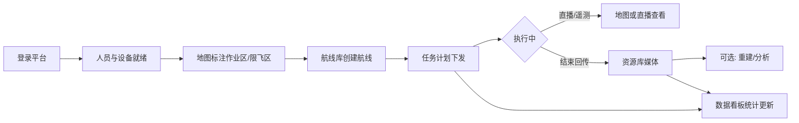

# 产品需求文档（PRD）— 单项目无人机云端作业平台（UAVPlatform）

| 文档版本 | 修改日期 | 修改人 | 修改内容 |
|----------|----------|--------|----------|
| V0.1 | 2026-07-21 | Auto | 基于司空平台截图与公开能力梳理初稿（单项目、无多项目概念） |
| V1.0 | 2026-08-24 | Auto | **实现基线定稿**：项目定名 UAVPlatform；确认与私有化司空 2 深度集成方案；新增 F-M10 空域安全、F-M11 司空集成模块；页面清单/验收标准按已实现前端路由更新；10.3 待确认项全部关闭 |

> **定稿状态（V1.0）**：与概要设计 V2.0 / 详细设计 V2.0 同步，反映 2026-08 实现基线。  
> **输入依据**：司空 2 界面截图与公开能力 + 私有化司空（192.168.76.141）集成实践。  
> **产品裁剪原则**：平台本身即唯一作业空间，**不提供「项目」创建、切换、列表与项目级隔离**；原「项目内」能力全部提升为平台级能力。

---

## 1. 产品背景和目标

### 1.1 背景

行业无人机作业已从「单机飞控」走向「云端协同」：需要远程看地图与直播、规划航线与任务、管理机场/飞行器、沉淀媒体与模型，并逐步引入 AI 检测与自动化工作流。司空类产品提供了成熟参考，但多项目组织模型对「固定场地、单一作业主体」场景偏重。

### 1.2 目标

打造一套 **单作业空间** 的 Web 云端作业平台（UAVPlatform，下称「本平台」），支持：

1. 一屏掌握资产、任务与飞行数据（数据看板）  
2. 在地图上完成标注、限飞/作业区与协同（地图作业）  
3. 管理航线、下发任务计划并跟踪执行，并复用司空驾驶舱/回放（航线与任务）  
4. 管理媒体/模型等成果，并支持司空 Terra 三维重建（资源与成果）  
5. 管理人员、角色与设备全生命周期（人员与设备）  
6. 与私有化司空 2 双向集成（设备/航线镜像、任务下发、安全区推送）

**V1.0 关键定位**：本平台 = 统一门户 + 业务编排 + 数据沉淀；司空 = 设备控制、航线编辑引擎、直播/回放媒体、Terra 重建的计算引擎。

### 1.3 成功标准（初稿）

- 管理员可在无「项目」概念下完成：加人 → 绑设备 → 画作业区 → 建航线 → 建计划 → 看媒体/看板  
- 关键作业链路（计划执行状态、媒体回传、设备在线状态）在看板或对应模块可追溯  
- 界面与信息架构清晰，单作业空间心智一致（无项目切换）

---

## 2. 产品范围

### 2.1 本期包含（P0/P1，V1.0 实现基线）

| 优先级 | 范围 |
|--------|------|
| P0（已实现） | 登录与账号；首页看板（指标 + 中央地图 + 在飞位置）；地图标注；空域安全（限飞区/作业区）；航线库（内嵌司空编辑器）；任务计划（下发司空）；媒体库；人员与角色；设备管理（本地 + 司空镜像）；司空集成通道；驾驶舱 |
| P1（已实现） | 模型/回收站；任务级三维重建；飞行回放；设备绑定码与定损反馈；看板任务图表；个人中心（邮箱/密码）；司空设备/航线镜像同步 |
| P2（占位/后置） | 智能搜索、变化检测 Pro、超清全景、多模态识别、算法管理独立页面（已下线）、工作流编排、国际化（英文包已实现） |

### 2.2 本期不包含

| 排除项 | 理由 |
|--------|------|
| 多组织 / 多项目 / 项目邀请码 / 项目归档 | 产品明确为单作业空间 |
| 跨项目资源迁移、项目级权限矩阵 | 无项目概念后统一为平台角色权限 |
| 私有化部署完整方案、OpenAPI 正式对外开放 | 可作为后续规划，本期不写死接口对外 SLA |
| Pilot 端完整交互规格 | 本期以 Web 为主；与现场端同步仅描述「设备同步」能力边界 |
| 完整 AI Agent / 大模型对话编排 | 截图有入口与指标，细节待算法管理专项 |

### 2.3 后续规划

- 算法管理：检测模型上架、告警规则、与直播/回放联动（后端 API 已备，页面待重启）  
- 自动化工作流：采集 → 重建 → 分析 → 报告拖拽编排  
- 高程 Tab（2.5D）与智能分析（搜索/变化检测/全景）  
- 与机场无人值守深度运维（远程调试细则、维保工单闭环）  
- 存储/会话外置（MinIO/Redis）与多实例部署

---

## 3. 用户故事与用例

### 3.1 用户角色

| 角色 | 描述与核心诉求 |
|------|----------------|
| **超级管理员** | 平台最高权限；管理人、设备、角色；可操作全部业务模块 |
| **管理员** | 日常运维负责人；配置标注/航线/任务；查看看板与成果 |
| **设备维护员** | 关注机场/飞行器绑定、固件、告警、定损反馈 |
| **作业员** | 查看地图与任务、使用航线与媒体；权限受限的编辑能力 |
| **只读观察者**（可选） | 仅看板与成果查看，不可改配置 |

> 说明：角色名可与司空对齐调整；本期至少落地「超级管理员 + 管理员 + 作业员」三档。

### 3.2 用户故事

1. 作为管理员，我希望打开数据看板一眼看到设备、任务与飞行统计，以便判断今日能否正常作业。  
2. 作为管理员，我希望在地图上绘制作业区与限飞区并同步到设备端，以便现场与云端规则一致。  
3. 作为作业员，我希望在航线库创建/编辑巡检航线，以便复用固定巡检路径。  
4. 作为管理员，我希望创建立即/定时/循环任务计划并选择航线与设备，以便机场自动执行。  
5. 作为作业员，我希望在资源库按巡检批次查看照片与直播回放，以便复盘与取证。  
6. 作为超级管理员，我希望添加人员并分配角色，以便控制谁能改设备与任务。  
7. 作为设备维护员，我希望用绑定码绑定机场并查看固件/工作状态，以便保障机队可用。

---

## 4. 业务流程

### 4.1 核心业务流程图

### 4.2 任务计划状态流转

| 当前状态 | 触发动作 | 目标状态 | 权限校验 |
|----------|----------|----------|----------|
| 草稿（可选） | 确认创建 | 待执行 | 管理员及以上 |
| 待执行 | 到达计划时间 / 立即执行 | 执行中 | 系统或管理员 |
| 待执行 | 暂停 | 已暂停 | 管理员及以上 |
| 已暂停 | 恢复 | 待执行 | 管理员及以上 |
| 执行中 | 执行成功 | 已完成 | 系统 |
| 执行中 | 失败 / 超时 | 失败 | 系统 |
| 执行中 | 人工结束 | 已结束 | 管理员及以上 |
| 部分完成 | 断点续飞 | 待执行（续飞任务） | 管理员及以上 |

### 4.3 设备在线状态（示意）

| 当前状态 | 触发 | 目标状态 |
|----------|------|----------|
| 离线 | 心跳恢复 | 在线（空闲/作业中/调试中等） |
| 在线空闲 | 开始任务 | 作业中 |
| 作业中 | 任务结束 | 空闲 |
| 任意 | 超时无心跳 | 离线 |

---

## 5. 功能需求

### 5.1 功能模块总览（V1.0）

| 编号 | 模块 | 说明 | 优先级 | 实现状态 | U-ID |
|------|------|------|--------|----------|------|
| M1 | 账号与权限 | 登录、角色、人员 CRUD、个人中心 | P0 | ✅ 已实现 | U-001～004、U-087 |
| M2 | 首页看板 | 资产/成果/任务/飞行数据 + 中央地图 + 在飞位置 | P0 | ✅ 已实现（报告/告警计数占位） | U-010～014、U-089 |
| M3 | 地图作业 | 标注、量测、设备同步 | P0 | ✅ 已实现 | U-020～023 |
| M4 | 航线库 | 文件夹、司空编辑器内嵌、导入导出 | P0 | ✅ 已实现 | U-030～032 |
| M5 | 任务计划 | 计划创建、策略、安全参数、状态管理、重建/回放 | P0 | ✅ 已实现（多模态开关后置） | U-040～044、U-086、U-091 |
| M6 | 资源库 | 媒体/模型/回收站；重建任务 | P0/P1 | ✅ 已实现（智能分析占位） | U-050～053、U-080 |
| M7 | 设备管理 | 本地设备 + 司空镜像 + 内嵌设备组件 + 绑定码/定损 | P0 | ✅ 已实现 | U-060～062、U-088 |
| M8 | 算法管理 | 后端 API（供任务校验与看板计数） | P2 | 🚧 后端已备，页面下线 | U-070～071 |
| M9 | 数据管理 | 与资源库同入口（/data 重定向 /library） | P1 | ✅ 方案 A 落地 | U-080 |
| M10 | 空域安全 | 限飞区（推送司空）+ 作业区（本地） | P0 | ✅ 已实现 | U-081～082 |
| M11 | 司空集成 | bootstrap/镜像同步/驾驶舱/飞行回放/实时位置 | P0 | ✅ 已实现 | U-083～085、U-088 |

> **与司空差异**：取消「项目」模块；顶栏直接进入各平台级页面。原项目成员/设备归属改为平台归属。  
> U-ID 编号源：`docs/03-design/preliminary/feature-uid-list.md`（V2.0）。

### 5.2 功能详情

#### 5.2.1 F-M1 账号与人员

- **[P0] 登录**：支持账号密码登录；登录后进入数据看板或作业台。  
  验收标准：错误密码有明确提示；成功进入已登录态页面。

- **[P0] 添加人员**：支持单个添加；记录账号、名称、角色、加入方式、加入时间。  
  验收标准：超级管理员可添加；列表可按角色筛选与关键词搜索。

- **[P0] 角色管理**：至少配置超级管理员 / 管理员 / 作业员权限集（模块可见 + 写操作）。  
  验收标准：作业员无法进入角色管理；无法删除超级管理员（或仅转移后可删）。

- **[P1] 编辑/删除人员**：支持编辑角色与删除（需二次确认）。  
  验收标准：删除后无法登录；操作写审计日志（若本期做审计）。

#### 5.2.2 F-M2 数据看板

- **[P0] 资产概览**：展示存储空间、建图数量、直播时长用量；机场状态分布（空闲/作业/调试/离线）；飞行器数、中继站数、人员数、航线数、AI 算法数。  
  验收标准：无数据时显示 0 或空态，不报错；有数据时与后台一致。

- **[P0] 数据成果**：媒体数、模型数、报告数、AI 目标告警数（可先接媒体/模型真实数，报告/告警可占位）。  
  验收标准：点击可跳转资源库对应分类（若已实现）。

- **[P1] 自动化与任务图表**：工作流数量、执行循环次数、成功率；任务分布（计划/手动）；执行结果（成功/暂停/失败）。  
  验收标准：支持本周/本月/上周/上月/近半年/近一年/自定义时间筛选。

- **[P0] 飞行数据**：飞行架次、飞行时长、飞行里程。  
  验收标准：随时间筛选变化；无任务时为 0。

- **[P0] 中央地图**：展示作业空间地图；支持缩放、2D/3D、指南针；底栏显示比例尺与坐标系信息（如 WGS84、ASL/HAE）。  
  验收标准：地图可加载；无设备时仍可浏览底图。

#### 5.2.3 F-M3 地图作业

- **[P0] 标注图层**：支持点/线/面；列表管理作业区、限飞区等；支持显示/隐藏。  
  验收标准：新建标注后地图与列表同时可见；可删除/重命名。

- **[P0] 量测工具**：距离、面积量测。  
  验收标准：量测结果有数值展示。

- **[P1] 高程/2.5D、航线快捷、安全相关 Tab**：与截图左侧 Tab 对齐，可分迭代。  
  验收标准：未实现 Tab 不展示或展示「即将推出」。

- **[P0] 设备同步**：将云端标注/区域规则同步到关联设备端。  
  验收标准：有同步入口与成功/失败反馈；无设备时提示先绑定设备。

#### 5.2.4 F-M4 航线库

- **[P0] 航线列表**：文件夹组织；按机型筛选；按时间排序；显示更新时间。  
  验收标准：空库有引导创建；支持搜索（P1）。

- **[P0] 创建/编辑航线**：支持常见类型（航点巡检、二维网状、斜面、几何体精细等——本期可先做航点 + 一种面状，其余类型可扩展）。  
  验收标准：保存后列表可见；编辑后更新时间变化。

- **[P1] 导入/导出**：支持 KMZ/行业约定格式导入导出与下载。  
  验收标准：非法文件有错误提示；合法文件可进入编辑器。

#### 5.2.5 F-M5 任务计划

- **[P0] 新建计划**：计划名称；任务类型（普通任务 / 航线任务 / 手动飞行任务）；选择航线与设备。  
  验收标准：必填项未填无法提交；提交后进入待执行或立即执行中。

- **[P0] 执行策略**：立即 / 单次定时 / 循环定时 / 连续执行。  
  验收标准：定时未到点不执行；循环按规则生成后续执行记录。

- **[P0] 安全与作业参数**：任务精度（RTK / GNSS）；断点续飞开关；智能返航规划开关；相对起飞点最低飞行高度；失联动作（返航 / 继续执行）。  
  验收标准：参数写入计划详情并可回看。

- **[P1] 多模态识别开关**：与算法能力联动；无算法时开关禁用并提示。  
  验收标准：禁用态不可开启。

- **[P0] 计划管理**：查看状态；暂停/恢复/删除/复制（按状态限制）。  
  验收标准：执行中删除需限制或二次确认；状态与 4.2 一致。

#### 5.2.6 F-M6 资源库

- **[P0] 媒体管理**：照片/视频/压缩文件分类；文件夹（如巡检批次、直播录制回放、全景图）；列表字段含名称、标签、拍摄负载、大小、创建时间；下载/分享入口（分享可 P1）。  
  验收标准：可创建文件夹、导入文件；存储占用与剩余空间展示正确。

- **[P1] 模型 / 设计文件 / 回收站**：分类存储与恢复删除。  
  验收标准：删除进回收站；回收站可还原或彻底删除。

- **[P1] 模型重建入口**：从媒体发起重建任务（异步）。  
  验收标准：有任务状态；完成后模型数或模型列表更新。

- **[P2] 智能搜索、变化检测 Pro、超清全景**：界面可先保留入口，能力可后置。  
  验收标准：未开通时有明确不可用说明。

#### 5.2.7 F-M7 设备管理

- **[P0] 设备分类 Tab**：机场/地面站、飞行器、其它物流设备。  
  验收标准：切换 Tab 列表隔离正确。

- **[P0] 设备列表字段**：型号、SN、名称、固件版本、固件升级、飞行安全数据库、工作状态、加入组织时间、在线时间、操作。  
  验收标准：无设备显示空态；支持按 SN/名称搜索。

- **[P0] 设备绑定码**：生成/查看绑定码，用于现场绑定机场或飞行器。  
  验收标准：有绑定码展示与「如何绑定」说明入口。

- **[P1] 设备定损与反馈**：问题报告入口。  
  验收标准：可提交描述并生成可追踪记录。

#### 5.2.8 F-M8 算法管理（占位）

- **[P2] 算法列表**：展示已接入算法数量与状态；与看板「AI 算法数」「AI 目标告警」对齐。  
  验收标准：无算法时为空态；不阻塞 P0 主流程。

#### 5.2.9 F-M9 数据管理

- **[P1] 数据管理入口**：**已定方案 A**——`/data` 重定向 `/library`，单一文件库入口。  
  验收标准：顶栏不出现重复且让人困惑的两个「文件库」。

#### 5.2.10 F-M10 空域安全（V1.0 新增，已实现）

- **[P0] 限飞区管理**：全屏地图页绘制多边形/圆形限飞区；名称/样式/半径编辑；删除。  
  验收标准：草稿与已落库区分展示；同步状态徽标可见。

- **[P0] 限飞区同步**：推送司空飞行安全区（逐台设备），回写同步状态。  
  验收标准：单台失败不影响其它设备；失败原因可查（sync_msg）；状态机 wait_sync→synchronizing→synchronized/fail。

- **[P0] 作业区管理**：绘制作业区（绿色边框），支持高度区间（min/max）与备注；仅本地存储不推送司空。  
  验收标准：编辑表单精简（名称/类型/样式/高度/描述）；列表与地图联动。

#### 5.2.11 F-M11 司空集成（V1.0 新增，已实现）

- **[P0] 集成通道**：bootstrap 下发 paas.js 配置与 token；SDK 状态可观测、可重载。  
  验收标准：换司空地址后 reload 生效；不可用时各页面明确提示。

- **[P0] 驾驶舱**：设备列表选择机场/飞行器 → loadCockpit 实时画面（含地图与直播）。  
  验收标准：切页卸载干净，不影响其它页面地图。

- **[P1] 飞行回放**：任务执行记录 → FlyDataReplay 回放（依赖 fh2_task_uuid）。  
  验收标准：无任务关联时按钮禁用并提示。

- **[P1] 镜像同步**：手动同步司空设备（拓扑 + 机场挂载飞行器）与航线到本地库；编辑器保存后自动回写镜像。  
  验收标准：source=fh2 标记；重复同步不产生重复记录。

- **[P1] 在飞位置**：首页地图叠加在飞飞行器机位与航向（轮询）。  
  验收标准：无可飞设备时无标记不报错。

#### 5.2.12 个人中心（V1.0 新增，已实现）

- **[P1] 个人信息维护**：查看基本信息；修改邮箱；修改密码（旧密码校验，改后重新登录）。  
  验收标准：旧密码错误有明确提示。

---

## 6. 界面交互说明

### 6.1 页面清单（V1.0 · 按实现路由）

| 页面 | 访问路径 | 对应功能 | 备注 |
|------|----------|----------|------|
| 登录页 | `/login` | M1 | |
| 首页（看板） | `/`（`/dashboard` 重定向） | M2 | 全屏地图 + 左右面板 |
| 地图标注 | `/map` | M3 | |
| 空域安全 | `/airspace` | M10 | 全屏 |
| 航线库 | `/waylines`（内嵌司空编辑器；`/waylines/editor` 兼容重定向） | M4 | |
| 任务列表 | `/missions` | M5 | |
| 新建计划 | `/missions/create` | M5 | 独立页 |
| 计划详情 | `/missions/:id` | M5 | 含执行/媒体/重建/回放入口 |
| 飞行回放 | `/missions/:planId/replay/:executionId` | M11 | 全屏 |
| 驾驶舱 | `/cockpit`、`/cockpit/detail` | M11 | 详情全屏 |
| 资源库 | `/library`（`/data` 重定向） | M6/M9 | |
| 人员管理 | `/members` | M1 | |
| 角色管理 | `/roles` | M1 | |
| 设备管理 | `/devices`（内嵌司空设备组件；`/devices/manager` 重定向） | M7 | |
| 个人中心 | `/profile` | M1 | |
| ~~算法管理~~ | ~~`/algorithms`~~ | M8 | 已下线，重定向首页 |

### 6.2 信息架构（V1.0 实现）

**顶栏（按权限码动态渲染）**：首页｜地图标注｜空域安全｜设备管理｜航线｜飞行计划｜驾驶舱｜媒体库｜人员｜角色  

**全屏页**：空域安全、航线编辑器（页内）、任务回放、驾驶舱详情（占用主区域，隐藏常规内边距）  

### 6.3 关键交互规则（V1.0 校准）

1. **无项目选择器**：任何页面不得出现「切换项目」「创建项目」。  
2. **空态**：列表无数据时给出主操作按钮（如添加人员、绑定设备、新建航线）。  
3. **危险操作**：删除人员/删除航线/删除计划/删除执行媒体需二次确认。  
4. **权限**：无权限模块菜单隐藏（前端按 permissions 权限码渲染）。  
5. **地图**：标注/限飞区工具与列表联动；选中列表项地图定位居中；首页叠加限飞区与在飞位置。  
6. **任务创建**：独立分步页表单分区（任务详情 → 航线设备 → 识别与精度 → 策略 → 安全参数）。  
7. **司空组件页**：装载失败展示错误与重试；切页必须即载即清理（防全局容器串染）。  
8. **国际化**：全部文案经 vue-i18n，中英双语可切换。

---

## 7. 非功能需求

### 7.1 性能

- 看板首屏关键指标接口 P95 &lt; 2s（内网或同等条件）  
- 地图平移缩放流畅；同时展示标注数量建议有分层/聚合策略（上限可后续定）  
- 媒体列表分页默认 50 条/页

### 7.2 安全

- 登录鉴权；会话超时退出  
- 按角色鉴权到模块与写操作  
- 绑定码具备有效期或刷新机制（建议）  
- 敏感操作审计（建议 P1）

### 7.3 可用性

- 关键写操作失败可重试并保留表单  
- 任务/重建等异步任务有状态可查

### 7.4 兼容性

- 浏览器：Chrome 最新两个大版本（主）；Safari / Edge 可用  
- 地图坐标系默认 WGS84；高度展示 ASL/HAE 需标注含义  
- 航线文件：优先兼容行业常见 KMZ（wpml）结构

### 7.5 可维护性

- 前后端错误码与用户可读文案分离  
- 关键链路日志：登录、绑设备、下发任务、媒体上传

---

## 8. 数据需求

### 8.1 数据实体概览

#### 8.1.1 用户（User）

账号、显示名、角色、状态、加入时间、加入方式。

#### 8.1.2 角色与权限（Role / Permission）

角色编码、权限点列表（模块 + 动作）。

#### 8.1.3 设备（Device）

类型（机场/飞行器/其它）、型号、SN、名称、固件版本、工作状态、在线时间、绑定时间。

#### 8.1.4 地图标注（Annotation）

类型（点/线/面）、名称、几何、样式、是否限飞/作业区、同步状态。

#### 8.1.5 航线（Wayline）

名称、机型、航线类型、文件/结构化参数、更新时间、文件夹。

#### 8.1.6 任务计划（MissionPlan）

名称、类型、关联航线、关联设备、策略、精度、安全参数、状态、计划/实际时间。

#### 8.1.7 媒体资源（MediaAsset）

名称、类型、标签、负载、大小、路径、创建时间、文件夹、来源（上传/直播录制/任务回传）。

#### 8.1.8 模型与重建任务（Model / ReconstructJob）

模型类型、状态、来源媒体、完成时间。

#### 8.1.9 用量与统计（Quota / FlightStat）

存储配额与已用、直播时长、建图张数；架次/时长/里程聚合。

### 8.2 数据约束

- 设备 SN 在平台内唯一  
- 单平台无多租户项目隔离；若未来多租户以「组织/租户」另议，不等于「项目」  
- 删除航线前需检查是否被「待执行/执行中」计划引用  
- 预估：媒体为主数据量；需对象存储与生命周期策略（后续）

---

## 9. 验收标准（V1.0 · 已按实现基线校准）

| 编号 | 验收项 | 预期结果 | 优先级 | 状态 |
|------|--------|----------|--------|------|
| A1 | 无项目概念 | 全站无创建/切换项目入口 | P0 | ✅
| A2 | 主路径闭环 | 加人→绑设备/同步司空设备→标注/限飞区→航线→计划下发→媒体/重建/回放/看板可走通 | P0 | ✅
| A3 | 首页看板 | 指标与时间筛选可用；空数据不崩溃；地图叠加限飞区与在飞位置 | P0 | ✅
| A4 | 空域安全 | 限飞区/作业区可创建编辑删除；限飞区可推送司空并回显状态 | P0 | ✅
| A5 | 航线 | 司空编辑器内嵌可创建/编辑/改名/删除，镜像同步到本地列表 | P0 | ✅
| A6 | 任务 | 立即/单次经 SDK、周期/连续经 dji2 REST 下发；状态回查映射正确；动作与状态机一致 | P0 | ✅
| A7 | 资源库 | 媒体上传/列表/下载；回收站/还原；配额展示 | P0 | ✅
| A8 | 人员设备 | CRUD/绑定码/定损；设备页含司空镜像同步与内嵌组件 | P0 | ✅
| A9 | 权限 | 作业员无法进行角色管理与关键危险操作；删人/登出即时踢下线 | P0 | ✅
| A10 | 司空集成 | bootstrap/镜像同步/驾驶舱/回放/实时位置可用；SDK 失败可观测可重载 | P0 | ✅
| A11 | 三维重建 | 按执行发起 Terra 重建；状态同步；模型可预览与 ZIP 下载 | P1 | ✅
| A12 | 个人中心 | 邮箱/密码修改可用，旧密码校验生效 | P1 | ✅
| A13 | 国际化 | 中英切换全站文案无缺失 | P2 | ✅ |
| A14 | 智能分析/多模态/高程 Tab | 未开通能力有明确不可用说明或隐藏 | P2 | 🚧 占位 |

---

## 10. 附录

### 10.1 术语表

| 术语 | 说明 |
|------|------|
| 单作业空间 | 本平台唯一业务容器，替代多项目模型 |
| UAVPlatform | 本平台正式名称（仓库目录 AiFlow） |
| 机场 | 无人机自动起降与换电等地面站设备（Dock） |
| 航线 | 预定义飞行路径与动作集合 |
| 任务计划 | 将航线与设备、时间策略绑定后的可执行任务 |
| 断点续飞 | 任务中断后从断点恢复继续执行 |
| ASL / HAE | 海拔高 / 椭球高 |
| 多模态识别 | 结合多类型输入的目标识别能力（可后置） |
| FH2 / 司空 | DJI FlightHub 2 私有化部署实例 |
| paas.js | 司空前端组件库（航线编辑器/设备管理/驾驶舱/回放） |
| binding_uuid | 司空工作空间绑定标识 |
| Terra | 司空三维重建引擎 |
| 镜像同步 | 将司空侧设备/航线拉取回写本地库（source=fh2） |

### 10.2 参考资料

- 本地截图：`D:\AiFlow` 下司空界面截图（看板、地图、航线、计划、资源库、人员、设备）  
- 司空 2 / FlightHub 2 公开产品与用户指南能力（用于能力映射，非逐字复制）  
- 私有化司空集成实践（见概要设计 V2.0 第 5 章关键流程）  
- 本 PRD 为 UAVPlatform 产品裁剪稿，非大疆官方文档

### 10.3 待确认项（V1.0 全部关闭）

1. 顶栏「数据管理」与「资源库」：**已定方案 A**（/data 重定向 /library）。  
2. 本期航线类型最低集合：**已定——航线编辑统一交给司空 WaylineEditor**（支持航点/面状等司空全部类型），本地库仅存镜像；本地导入导出保留。  
3. 是否必须含 Web 直播观看：**已定——P0，驾驶舱页 loadCockpit 实现**。  
4. 角色是否需要「设备维护员」独立角色：**已定——本期不独立**，种子为超管/管理员/作业员三档，可后台自建角色。  
5. 与现场端（Pilot）同步：**已定——P0 经司空通道**（设备/航线镜像同步 + 限飞区推送飞行安全区），另保留本地绑定码/同步任务作为非司空场景兼容。

---

## 11. 确认门控（V1.0 已通过）

- [x] 范围与「无项目」裁剪符合预期（已实现验证）  
- [x] P0/P1/P2 优先级已按实现基线固化  
- [x] 待确认项 10.3 全部关闭  

**后续变更**：新增需求请以 U-ID 追加（见 `docs/03-design/preliminary/feature-uid-list.md` V2.0），同步更新概要/详细设计对应分册。

**原型说明**：`docs/02-product/prototype/index.html` 为 V0.1 阶段静态原型，仅保留作历史参考；实际界面以 `frontend/src/views/` 实现为准（页面映射见 feature-uid-list.md）。
