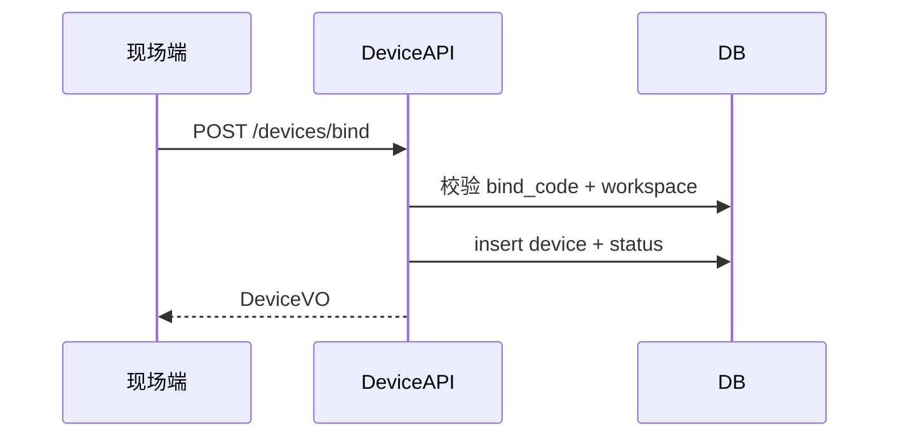

# 详细设计 · Device（U-060～U-062）· SDD

| 文档版本 | 修改日期 | 修改内容 |
|----------|----------|----------|
| V1.0 | 2026-07-22 | 初稿 |

**涉及表**：`t_device` `t_device_status` `t_bind_code` `t_device_issue_report`

**域错误码**

| 错误码 | 说明 |
|--------|------|
| 20001 | 设备 SN 已存在 |
| 20002 | 绑定码无效或过期 |
| 20003 | 设备不存在 |
| 20004 | 设备类型不匹配 |
| 20005 | 无在线设备可同步（供 Map 调用时透传） |

---

## U-060 · 设备分类列表

**优先级**：P0 · **权限**：`device:read`

### 接口 `GET /api/v1/devices`

| 参数 | 类型 | 必填 | 说明 |
|------|------|------|------|
| deviceType | string | 否 | dock/aircraft/other；对应 Tab |
| keyword | string | 否 | SN 或名称 |
| workStatus | string | 否 | |
| page/pageSize | int | 否 | |

**DeviceVO**

| 字段 | 类型 | 说明 |
|------|------|------|
| id | long | |
| sn | string | |
| name | string | |
| deviceType | string | |
| model | string | |
| firmwareVersion | string | |
| firmwareUpgradeStatus | string | latest/upgradable |
| flightSafetyDbVersion | string | |
| workStatus | string | |
| joinedAt | string | |
| onlineAt | string | |
| onlineState | string | 来自 status 表 |

### 业务规则

1. 默认过滤 `deleted=0`。  
2. Tab 切换仅改 `deviceType`，互斥列表。  
3. 详情可复用同 VO；远程运维本期占位不开放写接口。  

---

## U-061 · 设备绑定码

**优先级**：P0 · **权限**：查看/刷新 `device:write`；现场绑定接口用绑定码鉴权（非用户 Token）

### 接口

#### 获取当前有效绑定码 `GET /api/v1/bind-codes/current`

**BindCodeVO**：code, workspaceCode, workspaceId, expireAt, status

#### 刷新绑定码 `POST /api/v1/bind-codes/refresh`

- 旧码 `revoked`；生成新码，默认有效期 7 天（可配置）  
- 响应：BindCodeVO  

#### 现场端绑定 `POST /api/v1/devices/bind`（服务端开放给现场/机场代理）

| 参数 | 类型 | 必填 | 说明 |
|------|------|------|------|
| workspaceCode | string | 是 | 如 aiflow-workspace-001 |
| bindCode | string | 是 | |
| sn | string | 是 | |
| name | string | 是 | |
| deviceType | string | 是 | |
| model | string | 是 | |
| firmwareVersion | string | 否 | |

**规则**

1. 校验 workspace + bindCode status=active 且未过期，否则 `20002`。  
2. SN 冲突 `20001`。  
3. 成功插入 `t_device` + `t_device_status(offline/idle)`；可选将 bindCode 标记 used 或保持可多次绑定（**默认：绑定码在有效期内可绑定多台**，仅刷新会作废）。  
4. 发布领域事件 `DeviceBound`。  

---

## U-062 · 设备定损反馈

**优先级**：P1 · **权限**：`device:write`

### 接口

#### 创建 `POST /api/v1/device-issues`

| 参数 | 类型 | 必填 | 说明 |
|------|------|------|------|
| deviceId | long | 是 | |
| description | string | 是 | ≤1000 |

**响应**：id, trackingNo（服务端生成，如 `ISSUE-yyyyMMdd-******`）, status=submitted

#### 列表 `GET /api/v1/device-issues?deviceId=`

### 业务规则

设备不存在 → `20003`；创建后状态 submitted → processing → closed（后台人工，本期可仅 submitted）。
