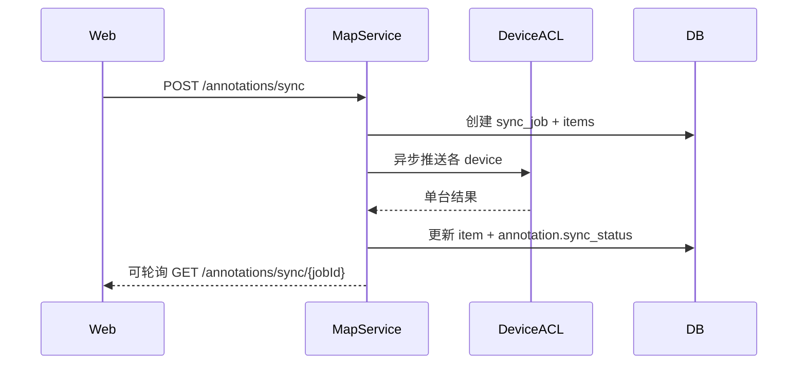

# 详细设计 · Map（U-020～U-023）· SDD

| 文档版本 | 修改日期 | 修改内容 |
|----------|----------|----------|
| V1.0 | 2026-07-22 | 初稿 |
| V2.0 | 2026-08-24 | **按实现校准**：地图引擎定为 Leaflet + 本地瓦片；安全 Tab 已落地为独立空域安全页（见 safety 分册）；补充首页叠加说明 |

**涉及表**：`t_annotation` `t_annotation_folder` `t_sync_job` `t_sync_job_item`；协作 `t_device`

**域错误码**

| 错误码 | 说明 |
|--------|------|
| 30001 | 标注不存在 |
| 30002 | 几何非法 |
| 30003 | 文件夹已锁定不可改 |
| 30004 | 无设备可同步 |
| 30005 | 同步任务进行中 |

---

## U-020 · 标注点线面 CRUD

**优先级**：P0 · **权限**：读 `map:read` / 写 `map:write`

### 接口

#### 列表 `GET /api/v1/annotations`

| 参数 | 类型 | 说明 |
|------|------|------|
| folderId | long | 可选 |
| purpose | string | work_area/no_fly/poi/other |
| visible | bool | 可选 |

#### 创建 `POST /api/v1/annotations`

| 参数 | 类型 | 必填 | 说明 |
|------|------|------|------|
| name | string | 是 | ≤128 |
| geomType | string | 是 | point/line/polygon |
| purpose | string | 否 | |
| geometry | object | 是 | GeoJSON Geometry，WGS84 |
| style | object | 否 | |
| folderId | long | 否 | |
| visible | bool | 否 | 默认 true |

#### 更新 `PUT /api/v1/annotations/{id}` / 删除 `DELETE /api/v1/annotations/{id}`

#### 文件夹 `GET/POST /api/v1/annotation-folders`

### AnnotationVO

id, name, geomType, purpose, geometry, style, visible, syncStatus, folderId, updatedAt

### 业务规则

1. GeoJSON 类型必须与 `geomType` 一致，否则 `30002`。  
2. 删除逻辑删除；列表默认不可见已删。  
3. 文件夹 `locked=1` 时禁止改其下标注 → `30003`。  
4. 变更后 `sync_status=pending`。  

### 规约

- geometry 存 JSON，不做服务端拓扑校验（可只做 bbox/坐标范围粗检）。  

---

## U-021 · 地图量测

**优先级**：P0 · **模块**：web

### 规约（已实现）

- **无后端接口**。  
- 前端 Leaflet 测距/测面，结果仅 UI 展示；本地瓦片（tiles_tianjin，XYZ）离线可用。  
- 若需持久化为标注，走 U-020 创建接口。  

---

## U-022 · 设备同步标注

**优先级**：P0 · **权限**：`map:write`

### 接口 `POST /api/v1/annotations/sync`

| 参数 | 类型 | 必填 | 说明 |
|------|------|------|------|
| annotationIds | long[] | 否 | 空=全部可见且 pending/需同步的 |
| deviceIds | long[] | 否 | 空=全部在线 dock/aircraft |

**响应 data**

| 字段 | 类型 | 说明 |
|------|------|------|
| syncJobId | long | |
| status | string | pending/running |

### 业务时序



#### 查询任务 `GET /api/v1/annotations/sync/{jobId}`

返回 job 状态、成功/失败数、message。

### 业务规则

1. 无目标设备 → `30004`。  
2. 已有 running 任务 → `30005`（或允许并行，默认串行）。  
3. Device ACL 失败记 item.failed，不回滚整单。  

---

## U-023 · 高程与安全 Tab

**优先级**：P1

### 接口 `GET /api/v1/map/tabs/meta`

**响应**

```json
{
  "tabs": [
    { "key": "annotation", "enabled": true },
    { "key": "elevation", "enabled": false, "reason": "P1 upcoming" },
    { "key": "wayline", "enabled": true, "route": "waylines" },
    { "key": "safety", "enabled": true, "route": "airspace" }
  ]
}
```

前端根据 `enabled` 展示或「即将推出」。

> **V2.0 状态**：safety Tab 已落地为独立全屏页 `/airspace`（限飞区 + 作业区，详见 [`detail-safety.md`](./detail-safety.md)）；elevation 仍占位。首页地图亦叠加限飞区与标注图层（见 analytics 分册 U-014）。
