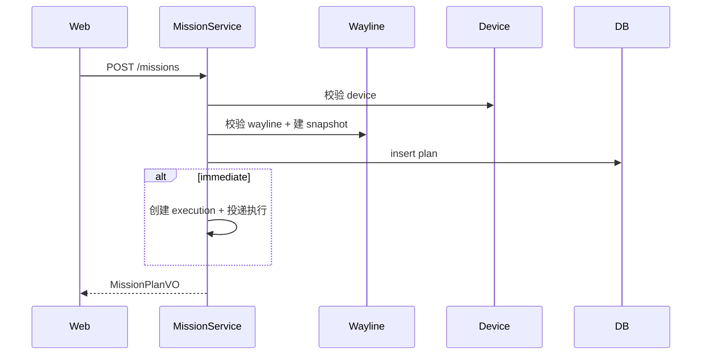
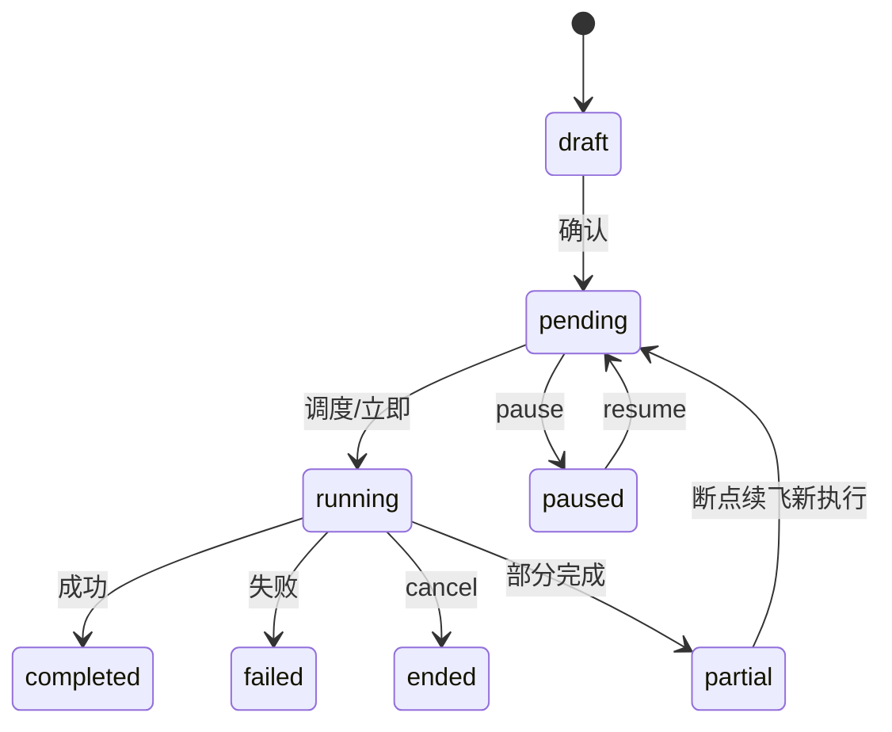

# 详细设计 · Mission（U-040～U-044）· SDD

| 文档版本 | 修改日期 | 修改内容 |
|----------|----------|----------|
| V1.0 | 2026-07-22 | 初稿 |

**涉及表**：`t_mission_plan` `t_mission_execution` `t_wayline_snapshot`；引用 `t_wayline` `t_device` `t_algorithm`

**域错误码**

| 错误码 | 说明 |
|--------|------|
| 50001 | 计划不存在 |
| 50002 | 航线不可用（不存在/未发布） |
| 50003 | 设备不可用 |
| 50004 | 状态不允许该操作 |
| 50005 | 必填参数缺失 |
| 50006 | 多模态不可用 |
| 50007 | 执行中禁止删除 |

---

## 公共：MissionPlanVO / CreateMissionCmd

**CreateMissionCmd（U-040+042+044 合一请求体）**

| 参数 | 类型 | 必填 | 说明 |
|------|------|------|------|
| name | string | 是 | ≤128 |
| taskType | string | 是 | normal/wayline/manual |
| waylineId | long | 条件 | wayline/normal 需要 |
| deviceId | long | 是 | |
| strategy | string | 是 | immediate/once/recurring/continuous |
| scheduleAt | string | 条件 | once/recurring/continuous |
| cronExpr | string | 条件 | recurring |
| accuracyMode | string | 是 | rtk/gnss |
| breakpointResume | bool | 否 | 默认 true |
| smartRth | bool | 否 | 默认 true |
| minFlightHeightM | number | 是 | 默认 60，范围建议 20～1500 |
| signalLostAction | string | 是 | rth/continue |
| multimodalEnabled | bool | 否 | 默认 false |

**MissionPlanVO**：上述字段 + id, status, waylineSnapshotId, createdAt, updatedAt, deviceName, waylineName

---

## U-040 · 新建任务计划

**优先级**：P0 · **权限**：`mission:write`

### 接口 `POST /api/v1/missions`

请求体：CreateMissionCmd  
响应：MissionPlanVO

### 业务规则

1. 校验设备存在且未删除 → 否则 `50003`。  
2. 需要航线时：航线 published → 否则 `50002`。  
3. **创建航线快照**：复制 content → `t_wayline_snapshot`，写入 `wayline_snapshot_id`。  
4. strategy=immediate → status=pending 并立即投递执行；once 等到 scheduleAt；recurring 写 cron。  
5. manual 任务可不绑航线。  

### 时序

---

## U-041 · 执行策略与调度

**优先级**：P0 · **实现**：MissionScheduler（内部组件）

### 规约

| strategy | 行为 |
|----------|------|
| immediate | 创建后入队 |
| once | 到 `schedule_at` 触发 |
| recurring | 按 `cron_expr` 生成多条 execution |
| continuous | 条件满足（电量等由设备侧回报）持续生成 |

调度扫描索引：`idx_mission_status_schedule`。  
每次触发插入 `t_mission_execution(status=pending)` 再下发 Device ACL。

**无独立 HTTP**；运维可留 `POST /api/v1/missions/scheduler/trigger`（仅内网/超管，可选）。

---

## U-042 · 安全与作业参数

**优先级**：P0

### 规约

参数包含在 CreateMissionCmd / Update（仅 pending 可改）中：

- `PUT /api/v1/missions/{id}` 允许改安全参数，当且仅当 status∈{draft,pending,paused}  
- 校验：minFlightHeightM 越界 → `40000`；枚举非法 → `40000`

写入后详情只读展示，执行侧下发 Device 时带上快照参数。

---

## U-043 · 计划状态管理

**优先级**：P0 · **权限**：`mission:write`（读列表 `mission:read`）

### 接口

#### 列表 `GET /api/v1/missions`

筛选：status, deviceId, keyword, page

#### 动作

| 方法 | 路径 | 说明 |
|------|------|------|
| POST | `/api/v1/missions/{id}/actions/pause` | 暂停 |
| POST | `/api/v1/missions/{id}/actions/resume` | 恢复 |
| POST | `/api/v1/missions/{id}/actions/cancel` | 结束/取消 |
| POST | `/api/v1/missions/{id}/actions/copy` | 复制为新计划（draft/pending） |
| DELETE | `/api/v1/missions/{id}` | 删除 |

### 状态机

| 当前 | 动作 | 目标 | 否则 |
|------|------|------|------|
| pending | pause | paused | 50004 |
| paused | resume | pending | 50004 |
| running | cancel | ended | |
| pending/paused/draft | delete | 逻辑删 | |
| running | delete | 50007 | |

复制：新计划引用**同一快照或重新快照**（默认重新从源 waylineId 快照；源已删则复制旧 snapshot 行）。

---

## U-044 · 多模态识别开关

**优先级**：P1

### 规约

创建/更新时若 `multimodalEnabled=true`：

1. 查询是否存在 `t_algorithm` status=enabled 且类型支持 multimodal/detection。  
2. 无 → `50006`，前端应禁用开关（可先调 `GET /api/v1/algorithms/capabilities`）。  

不单独提供开关接口，避免状态分裂。
