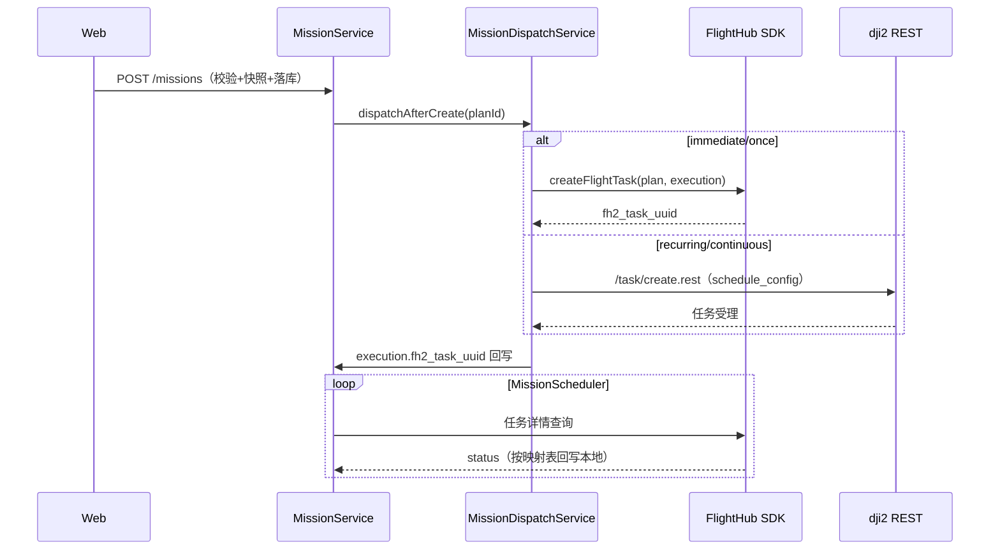
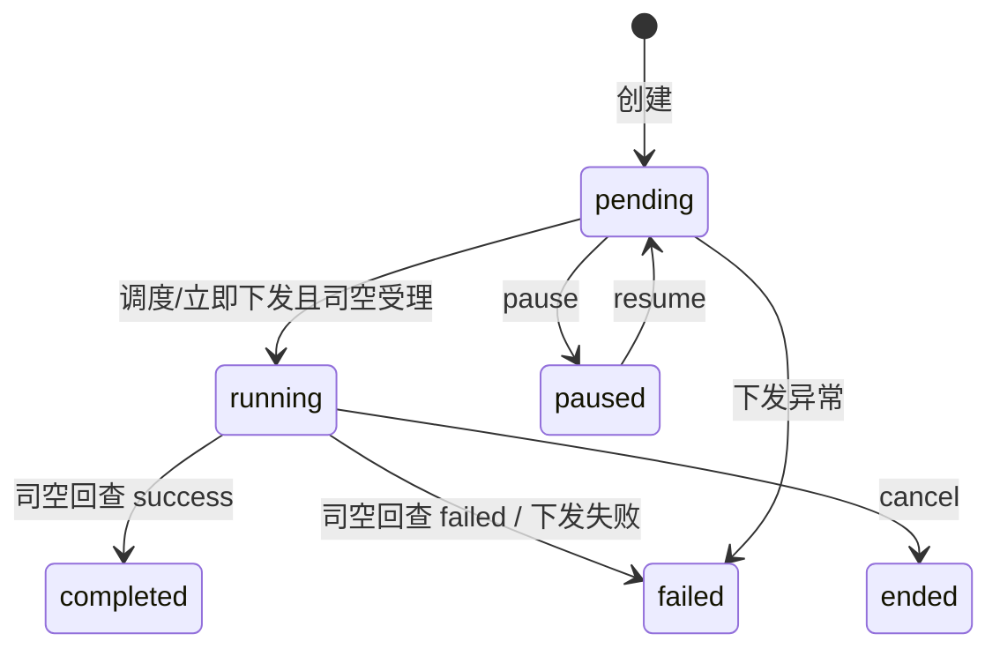

# 详细设计 · Mission（U-040～U-044、U-085 入口、U-086、U-091）· SDD

| 文档版本 | 修改日期 | 修改内容 |
|----------|----------|----------|
| V1.0 | 2026-07-22 | 初稿 |
| V2.0 | 2026-08-24 | **按实现校准**：下发通道改为司空（SDK 立即/单次 + dji2 REST 周期/连续）；执行记录关联 fh2_task_uuid；新增任务级三维重建（U-086）、执行媒体管理（U-091）、回放入口（U-085）；状态机与实际代码对齐 |
| V2.1 | 2026-09-15 | 新建任务航线选择器口径修复：前端原只查 status=published，漏掉 KMZ 导入的 draft 副本；改为拉全量后本地按 published 或 fh2WaylineUuid 非空过滤（与后端 requirePublishedWayline 一致），列表项顺带展示状态标签 |

**涉及表**：`t_mission_plan`（含 `schedule_config` JSON）、`t_mission_execution`（含 `fh2_task_uuid`）、`t_wayline_snapshot`；引用 `t_wayline`、`t_device`、`t_algorithm`、`t_reconstruct_job`

**域错误码**

| 错误码 | 说明 |
|--------|------|
| 50001 | 计划不存在 |
| 50002 | 航线不可用（不存在/未发布） |
| 50003 | 设备不可用 |
| 50004 | 状态不允许该操作 |
| 50005 | 必填参数缺失 |
| 50006 | 多模态不可用 |
| 50007 | 执行中禁止删除 |
| 50008 | 司空下发失败（MISSION_REMOTE_ERROR） |

---

## 公共：MissionPlanVO / CreateMissionCmd

**CreateMissionCmd（U-040+042+044 合一请求体，按实现）**

| 参数 | 类型 | 必填 | 说明 |
|------|------|------|------|
| name | string | 是 | ≤128 |
| taskType | string | 是 | normal/wayline/manual |
| waylineId | long | 条件 | wayline/normal 需要（司空镜像航线传本地镜像 id） |
| deviceId | long | 是 | |
| strategy | string | 是 | immediate/once/recurring/continuous |
| scheduleAt | string | 条件 | once/recurring/continuous |
| cronExpr | string | 条件 | recurring（兼容） |
| scheduleConfig | object | 否 | 策略明细 JSON：执行日期/时段/频率/电量阈值（周期/连续任务下发 dji2 用） |
| accuracyMode | string | 是 | rtk/gnss |
| breakpointResume | bool | 否 | 默认 true |
| smartRth | bool | 否 | 默认 true |
| minFlightHeightM | number | 是 | 默认 60 |
| signalLostAction | string | 是 | rth/continue |
| multimodalEnabled | bool | 否 | 默认 false |

**MissionPlanVO**：上述字段 + id, status, createdAt, updatedAt, deviceName, waylineName
**MissionPlanDetailVO**：MissionPlanVO + `executions`(MissionExecutionVO[])
**MissionExecutionVO**：id, planId, status, fh2TaskUuid, startedAt, endedAt, durationSec, breakpointInfo, media(ExecutionMediaVO[]), reconstruct(ExecutionReconstructVO)

---

## U-040 · 新建任务计划

**优先级**：P0 · **权限**：`mission:write`

### 接口 `POST /api/v1/missions`

前端 `/missions/create` 独立页分步表单（任务详情 → 航线设备 → 精度识别 → 策略 → 安全参数）。

### 业务规则（已实现）

1. 校验设备存在且未删除 → `50003`；需要航线时校验可用 → `50002`。航线可用口径（requirePublishedWayline）：`status=published` 或已回写 `fh2_wayline_uuid`（KMZ 导入的副本回写 uuid 后即为可用，即便仍是 draft）；前端新建页选择器同口径过滤并展示状态标签。
2. 复制航线内容建 `t_wayline_snapshot`。
3. manual 任务不下发司空（needsRemote=false），仅本地记录。
4. 创建事务提交后由 `MissionDispatchService.dispatchAfterCreate` 异步下发（见 U-041）。

---

## U-041 · 执行策略与调度（司空下发通道）

**优先级**：P0 · **实现**：MissionDispatchService + MissionScheduler + Dji2TaskClient

### 下发通道（已实现）

| strategy | 通道 | 说明 |
|----------|------|------|
| immediate / once | FlightHub Java SDK `FlightTaskModule.createFlightTask` | 事务提交后立即下发 |
| recurring / continuous | dji2 REST `/task/create.rest`；**未配置 `route-api-base`/userToken 时降级本地调度**（executions 到期逐次走 SDK 单次下发，taskType=1） | 私有化无 dji2 route 后台（56789 未部署）与 userToken，默认即降级 |
| manual | 不下发 | 本地记录 |

### 状态回查映射（FH2 TaskDetail.status → 本地 execution.status）

| FH2 status | 本地状态 |
|------------|----------|
| 0, 6, 9, 10 | pending |
| 2, 3 | running |
| 5, 8 | success |
| 1, 4, 7 | failed |

MissionScheduler 周期巡检未终结执行 → SDK 查任务详情 → 按上表回写；执行关联 `fh2_task_uuid`（同时是 FlyDataReplay 的 taskId）。

### 失败处理

- SDK 未初始化 → `50008`；周期任务 dji2 未配置 → **降级本地调度**（不报错，计划保持 pending，调度器到期逐次下发）；dji2 已配置但下发异常 → `50008`。
- 下发异常不回滚计划创建（保留 pending 可重试）。

---

## U-042 · 安全与作业参数

**优先级**：P0

参数随 CreateMissionCmd 落库；下发司空时携带（默认返航高度 120m 兜底）；详情页只读回看。校验：minFlightHeightM 越界/枚举非法 → `40000`。

---

## U-043 · 计划状态管理

**优先级**：P0 · **权限**：`mission:write`（读 `mission:read`）

### 接口

| 方法 | 路径 | 说明 |
|------|------|------|
| GET | `/api/v1/missions` | 列表：status/deviceId/keyword/分页 |
| GET | `/api/v1/missions/{id}` | 详情（含执行记录 + 媒体 + 重建态） |
| POST | `/api/v1/missions/{id}/actions/pause` | 暂停（同步暂停司空周期任务） |
| POST | `/api/v1/missions/{id}/actions/resume` | 恢复 |
| POST | `/api/v1/missions/{id}/actions/cancel` | 取消/结束 |
| POST | `/api/v1/missions/{id}/actions/copy` | 复制为新计划 |
| DELETE | `/api/v1/missions/{id}` | 删除 |

### 状态机（按实现校准）

规则：running 删除 → `50007`；copy 重新快照（源已删则复用旧 snapshot）。

---

## U-044 · 多模态识别开关

**优先级**：P1（后端校验已备，前端开关未开放）

`multimodalEnabled=true` 时校验存在 enabled 且支持 multimodal/detection 的算法（`GET /api/v1/algorithms/capabilities`），无 → `50006`。

---

## U-086 · 任务级三维重建

**优先级**：P1 · **权限**：`mission:write` · **实现**：MissionReconstructService

### 接口

| 方法 | 路径 | 说明 |
|------|------|------|
| POST | `/api/v1/missions/{planId}/executions/{executionId}/reconstruct` | 按执行发起司空 Terra 重建 |
| GET | `/api/v1/missions/{planId}/executions/{executionId}/reconstruct/model-url` | 已完成模型的 ZIP 下载地址 |

### 流程（已实现）

1. 校验执行存在且已关联 `fh2_task_uuid`。
2. 在司空任务资源文件夹（`fh2_task_folder_id`，取自配置 `terra-build-folder-uuid` 或任务详情）发起 Terra 重建。
3. `t_reconstruct_job` 落库：mission_plan_id + mission_execution_id + fh2_task_uuid + fh2_model_id。
4. 状态同步：详情打开时 `attachReconstruct(plan, executions)` 懒校准（司空已失败/无产物却标 success 的历史数据触发 `syncOne` 重查）。
5. 完成后 `preview_url`/`model_url`（TEXT）供前端 ModelPreviewDialog 预览与 ZIP 下载。

状态：pending → running → success | failed（与 media 分册 U-052 共表共状态）。

### 发起/按钮显示条件（V2.1）

仅当同时满足以下条件才显示可点击的三维重建（含失败后的重新重建）按钮，后端 `ExecutionReconstructVO.available` 下发，`unavailableReason` 携带首个不满足原因（no_task / no_media / not_area_wayline / active_job）：

1. 真实执行记录（recordType=execution）且已关联 `fh2_task_uuid`；
2. 该执行**已采集媒体**（本地 t_media_asset + 司空媒体合并后非空）；
3. 计划关联的是**面状航线**：本地 `t_wayline.wayline_type=grid_2d` 直接认定；否则按司空 `listWaylines.waylineTypes`（WaylineModelType，1=面状 Area）判定，命中后懒校准回写本地；类型进程内缓存 5 分钟（拉取失败冷却 60s）防详情页 5s 轮询打爆司空；
4. 无进行中的重建 job。

### 展示规则（V2.2）

- 详情接口 `MissionPlanVO.areaWayline` 下发计划级面状标志（detail 内复用 attachReconstruct 懒校准后的本地类型与缓存）；
- **航点/非面状航线**：执行列表不渲染三维重建列（v-if 整列隐藏）；
- **面状航线**：显示该列；其中无采集媒体（unavailableReason=no_media）的执行行按钮置灰（disabled + tooltip 提示），有采集媒体为可点击按钮；重建中/排队/已完成/失败状态展示不变。

发起接口同步同口径校验：非面状航线 → 50005；架次无司空采集照片 → 50008。司空镜像同步（syncWaylines）与编辑器保存回写（upsertWaylineFromEditor）也按 waylineTypes 校准本地类型。

---

## U-091 · 执行记录媒体管理

**优先级**：P1 · **权限**：`mission:write`

### 接口 `DELETE /api/v1/missions/{planId}/executions/{executionId}/media/{mediaId}`

`mediaId` 兼容两种口径：司空 fileId（源图在司空侧）或本地 `t_media_asset.id`。

### 展示（前端任务详情页）

执行记录行展开：媒体缩略/下载（`fetchMediaDownloadUrl` 或司空临时 URL）、删除（二次确认）、重建按钮（U-086）、回放按钮（U-085，无 fh2_task_uuid 时禁用并提示）。
