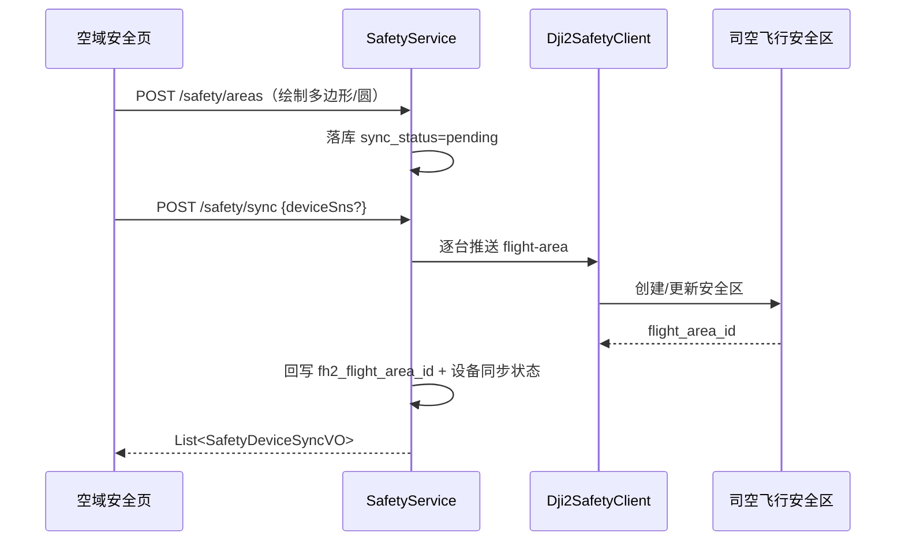

# 详细设计 · Safety / WorkArea 空域安全（U-081、U-082）· SDD

| 文档版本 | 修改日期 | 修改内容 |
|----------|----------|----------|
| V2.0 | 2026-08-24 | 新增分册：空域安全模块（限飞区 + 作业区），前端 `/airspace` 全屏页 |

**涉及表**：`t_safety_area`（含 `fh2_flight_area_id`）、`t_safety_device_sync`、`t_work_area`

**域错误码**

| 错误码 | 说明 |
|--------|------|
| 30010 | 限飞区不存在 |
| 30011 | 几何非法（类型与坐标不匹配/缺半径） |
| 30012 | 司空推送失败（透传 message） |
| 30020 | 作业区不存在 |

---

## U-081 · 空域限飞区管理

**优先级**：P0 · **权限**：读 `map:read`（或 `dashboard:read`，首页叠加）/ 写 `map:write`

### 接口（SafetyController `/api/v1/safety`）

| 方法 | 路径 | 说明 |
|------|------|------|
| GET | `/areas` | 列表（按 updatedAt 倒序） |
| POST | `/areas` | 创建 |
| PUT | `/areas/{id}` | 更新 |
| DELETE | `/areas/{id}` | 删除（本地 + 司空侧解绑标记） |
| POST | `/sync` | 推送限飞区到司空飞行安全区（body: deviceSns?） |
| GET | `/sync-status?deviceSns=` | 设备同步状态列表 |

**SafetyAreaSaveRequest**：`name`(必填 ≤128), `zoneType`(必填 3=多边形/4=圆形), `content`(必填 GeoJSON Feature), `color`(默认 #E23C39), `lineWidth`(默认 4), `radiusM`(圆形必填), `clampToGround`(默认 true)

**SafetyAreaVO**：id, name, zoneType, content, color, lineWidth, radiusM, clampToGround, syncStatus(pending/synced/failed), fh2FlightAreaId, updatedAt

### 业务规则

1. 几何校验：GeoJSON 类型与 zoneType 一致，圆形需 radiusM → 否则 `30011`。
2. 创建/更新后 `sync_status=pending`，并 `markDevicesNeedResync()`（全部设备置 wait_sync）。
3. 同步流程（`Dji2SafetyClient` → 司空 flight-area API）：
   - 按 `zone_hash`（内容指纹）判断是否变更；
   - 推送成功回写 `fh2_flight_area_id` + `sync_status=synced`；
   - 单台设备失败不回滚整单：`t_safety_device_sync.sync_status=fail` + `sync_msg`。

### 设备同步状态机（t_safety_device_sync.sync_status）

`wait_sync → synchronizing → synchronized | fail`（失败可重试，保留 sync_msg）

---

## U-082 · 作业区管理

**优先级**：P0 · **权限**：读 `map:read` / 写 `map:write`（**不推送司空，纯本地**）

### 接口（WorkAreaController `/api/v1/work-areas`）

| 方法 | 路径 | 说明 |
|------|------|------|
| GET | `/` | 列表 |
| POST | `/` | 创建 |
| PUT | `/{id}` | 更新 |
| DELETE | `/{id}` | 删除 |

**WorkAreaSaveRequest**：`name`(必填 ≤128), `zoneType`(3/4), `content`(GeoJSON), `color`(默认 #2EB85C 绿), `lineWidth`(4), `radiusM`(圆形), `clampToGround`(true), `minAltitude`(米，可空), `maxAltitude`(米，可空), `description`(≤500), `status`(active/inactive)

### 规则

1. 作业区仅本地持久化，用于前端地图展示与任务规划参考，不推送司空。
2. `minAltitude ≤ maxAltitude` 校验（两者均填写时）。
3. 逻辑删除。

---

## 前端页面（/airspace，全屏）

1. 左侧区域列表：合并限飞区 + 作业区两组（Tab 或分组），显示显隐开关与同步状态徽标。
2. 地图绘制：新建限飞区进入绘制态（多边形/圆形），草稿（本地临时 ID）与已落库记录区分（isDraftZone）。
3. 编辑表单精简配置：名称/类型/样式/半径/高度区间/描述。
4. 「同步到设备」按钮 → `/safety/sync` → 结果徽标刷新（hasServerSyncStatus 标记服务端状态已刷新）。
5. 本地快照（noflyZoneStorage/workAreaStorage）作为断网兜底，服务端数据优先。
