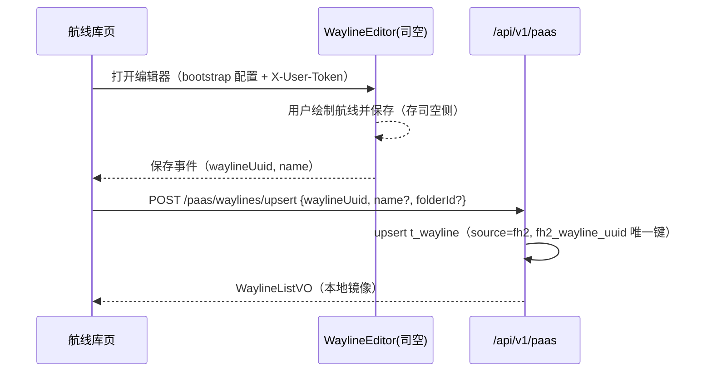

# 详细设计 · Wayline（U-030～U-032）· SDD

| 文档版本 | 修改日期 | 修改内容 |
|----------|----------|----------|
| V2.0 | 2026-08-24 | 按已实现代码补齐（V1.0 空缺）；航线编辑主通道改为司空 WaylineEditor，本地库保留镜像与导入导出 |
| V2.1 | 2026-09-14 | U-032 落地真实现：KMZ 结构校验/元数据提取/本体落盘/导出降级链；错误码表与 ErrorCodes.java 对齐 |
| V2.2 | 2026-09-14 | 导入双通道：支持导出封装 JSON（uav-wayline-export v1）再导入，导出→导入闭环；旧版 txt 导出拒收 |
| V2.3 | 2026-09-14 | 镜像恢复回写：导入封装 JSON 携带 fh2WaylineUuid 时回写（同 uuid 已存在则恢复更新原记录，upsert），恢复后可在编辑器打开；status 仅接受 draft/published |
| V2.4 | 2026-09-14 | 导出 KMZ 优先三级链（本地本体→司空镜像 getWaylineDetail URL 下载→封装 JSON）；导入 KMZ 自动 importKmz 上传司空并回写 uuid（事件+轮询双通道），upsert 恢复返回 restored 标志 |
| V2.5 | 2026-09-15 | 导出 KMZ 剥离 wpml:actionUUID（司空在线任务录制媒体回联键）：司空导入会按该键建空 action-media 骨架，编辑器对空骨架弱比较误报"航点位置已变更"；剥离后副本不再误报（实测骨架不建、编辑器无警告） |

**涉及表**：`t_wayline`（含 `fh2_wayline_uuid`(uk)、`source` 增量列）、`t_wayline_folder`、`t_wayline_content`

**域错误码**

| 错误码 | 说明 |
|--------|------|
| 40001 | 航线不存在（WAYLINE_NOT_FOUND） |
| 40002 | 航线名称非法（WAYLINE_NAME_INVALID） |
| 40003 | KMZ 解析失败（WAYLINE_PARSE_FAIL） |
| 40004 | 航线被运行中任务引用不可删除（WAYLINE_IN_USE） |
| 40005 | 航线类型不在白名单（WAYLINE_TYPE_UNSUPPORTED） |
| 40006 | 文件夹不存在（WAYLINE_FOLDER_NOT_FOUND） |
| 40007 | 文件夹下存在航线不可删除（WAYLINE_FOLDER_NOT_EMPTY） |

---

## 公共：WaylineListVO / WaylineDetailVO

**WaylineListVO**：id, name, folderId, folderName, aircraftModel, waylineType, status, source(local/fh2), fh2WaylineUuid, createdAt, updatedAt

**WaylineDetailVO**：上述 + `content`(结构化航线参数，本地航线有效)

---

## U-030 · 航线列表与文件夹

**优先级**：P0 · **权限**：读 `wayline:read` / 写 `wayline:write`

### 接口

| 方法 | 路径 | 说明 |
|------|------|------|
| GET | `/api/v1/waylines` | 分页：folderId/aircraftModel/status/keyword/page/pageSize |
| GET | `/api/v1/wayline-folders` | 文件夹列表（含航线计数） |
| POST | `/api/v1/wayline-folders` | 新建文件夹（name, parentId 可选） |
| DELETE | `/api/v1/wayline-folders/{id}` | 删除文件夹（默认文件夹不可删） |

前端 `/waylines` 页：左侧文件夹树 + 右侧航线列表（机型筛选、关键词搜索、更新时间排序）；「同步司空航线」按钮触发 U-088 镜像同步。

---

## U-031 · 航线创建与编辑（司空 WaylineEditor 通道）

**优先级**：P0 · **权限**：`wayline:write`

### 本地接口（镜像维护）

| 方法 | 路径 | 说明 |
|------|------|------|
| POST | `/api/v1/waylines` | 本地创建（名称/机型/类型/参数） |
| PUT | `/api/v1/waylines/{id}` | 本地编辑 |
| GET | `/api/v1/waylines/{id}` | 详情 |
| DELETE | `/api/v1/waylines/{id}` | 删除本地航线 |
| DELETE | `/api/v1/waylines/uuid/{waylineUuid}` | 按司空 uuid 删除镜像（编辑器内删除联动） |

### 编辑器集成（已实现）

1. 航线库页内嵌 `WaylineEditorPane`：经 `/api/v1/paas/bootstrap` 装载司空 WaylineEditor SDK（css/js 动态注入）。
2. 新建：`mode=create` 打开编辑器，保存后司空生成 `waylineUuid` → 前端调 `POST /api/v1/paas/waylines/upsert` 回写本地镜像（名称为空时服务端从司空拉取最新名称）。
3. 编辑：`mode=edit&waylineId=` 打开编辑器（传司空 uuid）；改名后即时刷新左侧列表（waylineNameSync）。
4. 删除：编辑器/列表删除司空航线 → `DELETE /waylines/uuid/{uuid}` 清理本地镜像。
5. 保存可能向当前文件夹插入新航线 → 前端并行刷新 folders + waylines 计数。

---

## U-032 · 航线导入导出（本地通道）

**优先级**：P1 · **权限**：导入 `wayline:write` / 导出 `wayline:read`

### 接口

| 方法 | 路径 | 说明 |
|------|------|------|
| POST | `/api/v1/waylines/import`（multipart file + folderId? + aircraftModel?） | 导入 KMZ，成功返回 WaylineDetailVO |
| GET | `/api/v1/waylines/{id}/export` | 导出（attachment 下载） |

规则：解析失败 → `40003`（WAYLINE_PARSE_FAIL）；multipart 上限 20MB（超限归一为 40000 提示）。

### 导入链路（双通道：KMZ / 导出封装 JSON）

**KMZ 通道**（zip 魔数 PK 判定，WaylineKmzParser + WaylineKmzStore）：

1. **结构校验**：非 zip、缺少 `wpmz/` 目录、或 wpmz 下无 `template.kml`/`waylines.wpml` 均拒收（40003）；单条目解压上限 32MB 防炸弹。
2. **元数据尽力提取**：航线名取 template.kml 首个 `<name>`（XML 实体还原），回退文件名去 `.kmz` 后截断 60 字；航点数按 `<Placemark>` 计数；提取失败不阻塞导入。
3. **落盘落库**：KMZ 本体存 `uav.wayline.storage-dir`（默认 `./data/waylines`，环境变量 `WAYLINE_STORAGE_DIR` 覆盖），storage_key=`import/{uuid}.kmz`（读取时校验归一化路径防穿越）；checksum=KMZ 字节 SHA-256；structuredParams 存导入摘要（sourceFilename/fileSizeBytes/waypointCount）；status=draft、source=local、机型回退 M350 RTK。
4. **云同步（可编辑闭环）**：落库成功且 SDK 可用即异步 `importKmz` 上传司空——关联键取 asyncRequestId，为空（实测私有化环境返回空串）时回退 kmzObjectKey（`wayline/import/{uuid}.kmz`）；uuid 回写走双通道：司空导入事件（`listenImportWaylineEvent`，实测私有化环境不推送，仅作快路径）与 6s×3 轮询兜底（按 kmz 文件名==司空默认航线名匹配 listWaylines，并排除本地已占用 uuid——导出→导入的副本与原航线在司空侧同名并存，避免误关联到旧航线），回写后调 updateWaylineName 将司空侧航线名同步为本地名。前端导入成功提示「正在同步司空（稍后可编辑）」并延时 9s 刷新列表；点击进编辑器时若列表快照 uuid 仍为空，实时拉详情补判一次（避免回写已完成仍被旧快照拦下）。
5. **删除联动**：航线删除（含司空镜像清理）同步删除本地 KMZ 本体，避免孤儿文件。

**导出封装 JSON 通道**（WaylineExportCodec）：非 zip 内容按 `{format:"uav-wayline-export",version:1,wayline:{元数据},structuredParams?}` 恢复——名称/机型/类型/structuredParams 原样回填（类型不在白名单时回退 waypoint），无 KMZ 本体；缺少 format 标记（含旧版 txt 导出）拒收 40003。

**镜像恢复回写**：导出封装携带 `fh2WaylineUuid`（司空镜像）时，导入按 uuid 恢复——

- 本工作空间已存在同 uuid 记录 → 恢复更新原记录（name/status/structuredParams，upsert），避免同一司空航线双份镜像；返回 `restored=true`，前端提示「已恢复到既有航线（未新增列表项）」；
- 不存在 → 新建后回写 uuid；status 仅接受 draft/published（其余回退 draft）。

回写 uuid 后（封装 JSON 恢复，或 KMZ 导入经云同步回写）航线即可在编辑器打开；尚未回写 uuid 的刚导入本地航线不支持编辑，仅可导出/删除。

### 导出链（KMZ 优先，三级降级）

1. storage_key 指向的本地 KMZ 本体存在 → `application/vnd.google-earth.kmz`，「航线名.kmz」，可再导入；
2. 司空镜像（fh2_wayline_uuid 非空且 SDK 可用）→ `getWaylineDetail` 取临时下载 URL 下载 KMZ 本体（私有化自签证书走 trust-all SSL），同样产出 .kmz，同样可再导入；
3. 以上均不可用（下载失败/SDK 不可用）→ 导出 `uav-wayline-export` 封装 JSON（含元数据+structuredParams+fh2WaylineUuid，司空镜像航线也可导出），「航线名.json」，再导入按镜像恢复回写处理。

导出的 KMZ（本链第 1/2 级）统一剥离 `wpml:actionUUID`（template.kml 与 waylines.wpml 成对）：司空"在线任务录制"的实拍照片按该键回联到拍照动作，而司空导入 KMZ 时也会按它为拍照动作创建**空 action-media 骨架**，编辑器打开副本时对空骨架弱比较（`create_at=undefined!==-1` 误判已归档、`shoot_position={}` 比对 NaN）会误报「航点位置已变更，请检查当前动作」。剥离后司空不再建骨架（实测 action-media 返回空、编辑器无警告），副本误报消除；原航线既有媒体归档不受影响。无该元素或处理失败时按原样导出。

文件名走 RFC 5987（`filename*=UTF-8''`）支持中文，非法字符归一为下划线。

> 定位说明：司空航线以 WaylineEditor 为唯一权威编辑通道；本地导入导出服务于非司空航线（source=local）的备份与迁移。
