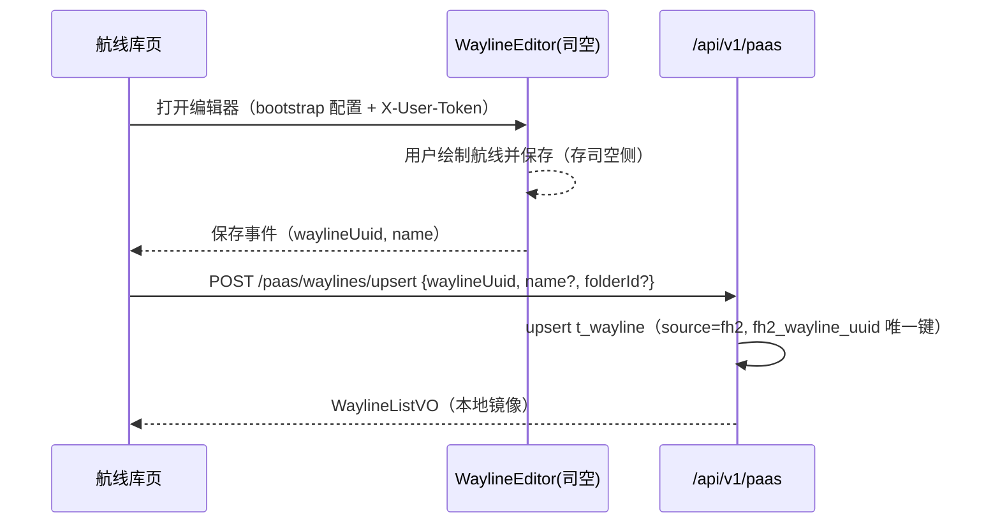

# 详细设计 · Wayline（U-030～U-032）· SDD

| 文档版本 | 修改日期 | 修改内容 |
|----------|----------|----------|
| V2.0 | 2026-08-24 | 按已实现代码补齐（V1.0 空缺）；航线编辑主通道改为司空 WaylineEditor，本地库保留镜像与导入导出 |

**涉及表**：`t_wayline`（含 `fh2_wayline_uuid`(uk)、`source` 增量列）、`t_wayline_folder`

**域错误码**

| 错误码 | 说明 |
|--------|------|
| 40001 | 航线不存在 |
| 40002 | 航线文件非法（导入解析失败） |
| 40003 | 文件夹不存在 |
| 40004 | 文件夹下存在航线不可删除 |

---

## 公共：WaylineListVO / WaylineDetailVO

**WaylineListVO**：id, name, folderId, folderName, aircraftModel, waylineType, status, source(local/fh2), fh2WaylineUuid, createdAt, updatedAt

**WaylineDetailVO**：上述 + `content`(结构化航线参数，本地航线有效)

---

## U-030 · 航线列表与文件夹

**优先级**：P0 · **权限**：读 `wayline:read` / 写 `wayline:write`

### 接口

| 方法 | 路径 | 说明 |
|------|------|------|
| GET | `/api/v1/waylines` | 分页：folderId/aircraftModel/status/keyword/page/pageSize |
| GET | `/api/v1/wayline-folders` | 文件夹列表（含航线计数） |
| POST | `/api/v1/wayline-folders` | 新建文件夹（name, parentId 可选） |
| DELETE | `/api/v1/wayline-folders/{id}` | 删除文件夹（默认文件夹不可删） |

前端 `/waylines` 页：左侧文件夹树 + 右侧航线列表（机型筛选、关键词搜索、更新时间排序）；「同步司空航线」按钮触发 U-088 镜像同步。

---

## U-031 · 航线创建与编辑（司空 WaylineEditor 通道）

**优先级**：P0 · **权限**：`wayline:write`

### 本地接口（镜像维护）

| 方法 | 路径 | 说明 |
|------|------|------|
| POST | `/api/v1/waylines` | 本地创建（名称/机型/类型/参数） |
| PUT | `/api/v1/waylines/{id}` | 本地编辑 |
| GET | `/api/v1/waylines/{id}` | 详情 |
| DELETE | `/api/v1/waylines/{id}` | 删除本地航线 |
| DELETE | `/api/v1/waylines/uuid/{waylineUuid}` | 按司空 uuid 删除镜像（编辑器内删除联动） |

### 编辑器集成（已实现）

1. 航线库页内嵌 `WaylineEditorPane`：经 `/api/v1/paas/bootstrap` 装载司空 WaylineEditor SDK（css/js 动态注入）。
2. 新建：`mode=create` 打开编辑器，保存后司空生成 `waylineUuid` → 前端调 `POST /api/v1/paas/waylines/upsert` 回写本地镜像（名称为空时服务端从司空拉取最新名称）。
3. 编辑：`mode=edit&waylineId=` 打开编辑器（传司空 uuid）；改名后即时刷新左侧列表（waylineNameSync）。
4. 删除：编辑器/列表删除司空航线 → `DELETE /waylines/uuid/{uuid}` 清理本地镜像。
5. 保存可能向当前文件夹插入新航线 → 前端并行刷新 folders + waylines 计数。

---

## U-032 · 航线导入导出（本地通道）

**优先级**：P1 · **权限**：`wayline:write`

### 接口

| 方法 | 路径 | 说明 |
|------|------|------|
| POST | `/api/v1/waylines/import`（multipart file + folderId? + aircraftModel?） | 导入航线文件 |
| GET | `/api/v1/waylines/{id}/export` | 导出（attachment 下载） |

规则：解析失败 → `40002`；导入成功返回 WaylineDetailVO 并进入列表。

> 定位说明：司空航线以 WaylineEditor 为唯一权威编辑通道；本地导入导出服务于非司空航线（source=local）的备份与迁移。
