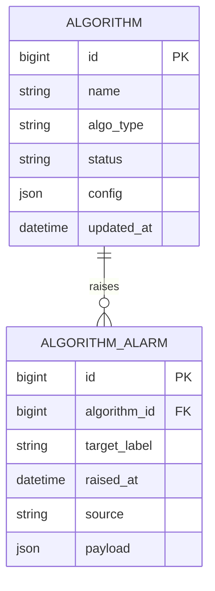

# E-R · 算法（Algorithm）· P2

## 限界上下文

算法上架、启停与告警计数；本期可占位，E-R 仍全量建模。

| 实体 | 聚合根 | 说明 |
|------|--------|------|
| Algorithm | 是 | 检测/多模态等算法 |
| AlgorithmAlarm | 是或从属于 Algorithm | AI 目标告警 |

## 领域事件

| 事件 | 订阅方 |
|------|--------|
| AlgorithmEnabled | Analytics（算法数） |
| AlarmRaised | Analytics（告警数） |
