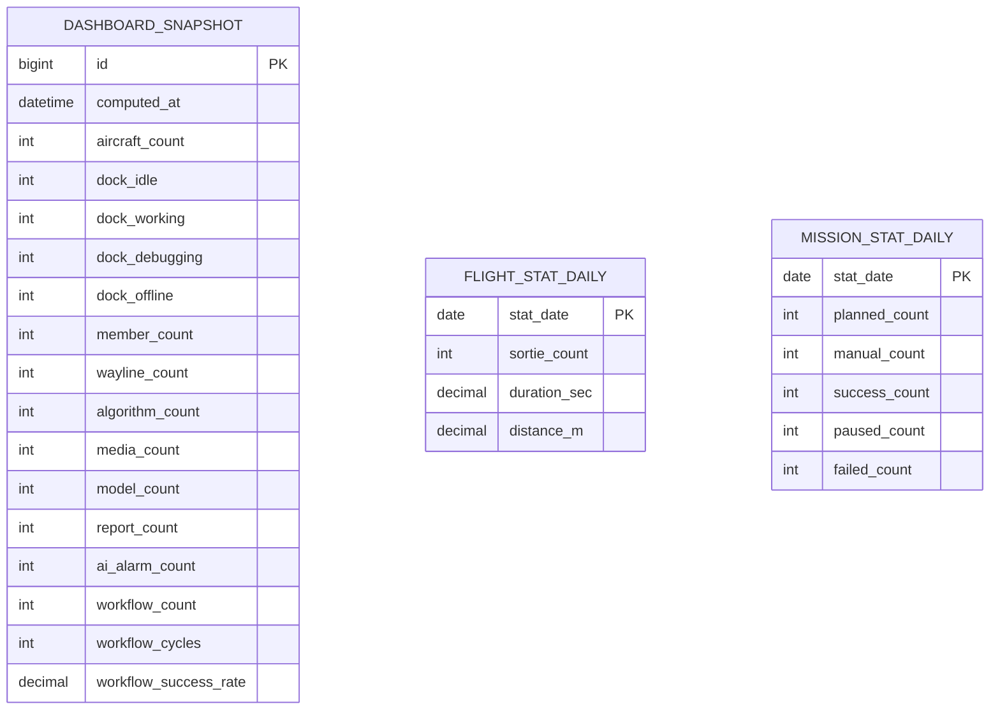

# E-R · 看板分析（Analytics）

## 限界上下文

**读模型上下文**：聚合各域事件，为数据看板提供指标与时间维统计；不反向修改业务聚合。

## 核心模型

## 说明

- 看板首屏可直接读 `DASHBOARD_SNAPSHOT` + 当日/筛选区间聚合表  
- 时间筛选：本周/本月/上周/上月/近半年/近一年/自定义 → 查询 `*_DAILY` 汇总  
- 实现可选：定时批处理 或 事件驱动增量更新  

## 领域事件（订阅）

订阅：`UserCreated`、`DeviceStatusChanged`、`WaylineCreated`、`Mission*`、`MediaUploaded`、`QuotaChanged`、`AlarmRaised` 等。
