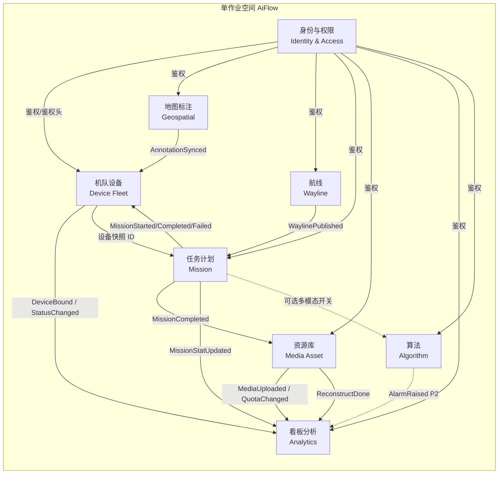

# 限界上下文关系图（Context Map）

| 文档版本 | 修改日期 | 修改内容 |
|----------|----------|----------|
| V1.0 | 2026-07-21 | 初稿：单作业空间 AiFlow |

---

## E-1. 限界上下文总览

### 上下文依赖说明

| 上游 → 下游 | 依赖类型 | 说明 |
|-------------|----------|------|
| IAM → 各业务上下文 | 同步 API / 网关鉴权 | 登录态、RBAC 校验 |
| Device → Mission | ID 引用 + 事件 | 计划绑定设备；执行时驱动设备状态 |
| Wayline → Mission | ID 引用 | 计划绑定航线（可快照副本） |
| Mission → Media | 领域事件 | 任务结束触发媒体归属/回传登记 |
| Mission → Analytics | 领域事件 | 更新飞行架次/时长/里程与任务图表 |
| Map → Device | 应用服务调用 / 异步任务 | 「设备同步」下发标注与限飞规则 |
| Media → Analytics | 事件 | 用量、媒体/模型计数 |
| Algorithm → Analytics | 事件（P2） | AI 告警计数 |
| Mission → Algorithm | 可选配置引用（P2） | 多模态识别开关 |

### 集成关系类型（DDD）

- **客户-供应商**：Mission 依赖 Device / Wayline 提供合法引用  
- **遵奉者**：Analytics 为读模型，遵奉各上下文事件，不反向写业务聚合  
- **开放主机服务**：IAM 对全平台提供认证授权  
- **防腐层（建议）**：对接机场/飞行器厂商协议、KMZ/WPML、对象存储时置于 Device / Wayline / Media 边界
