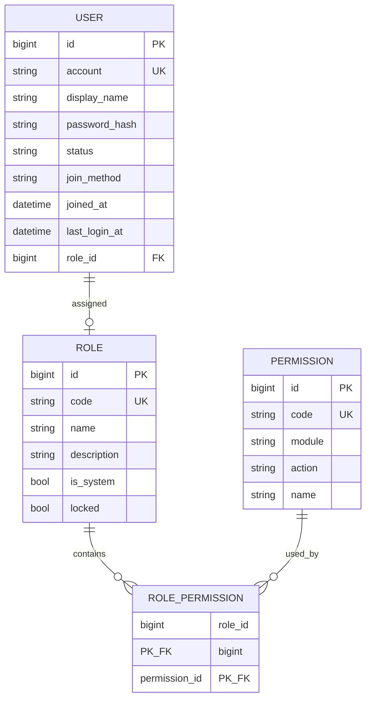

# E-R · 身份与权限（Identity & Access）

## 限界上下文

管理登录账号、角色与权限点；**无多项目**，权限直接作用于平台模块。

## 核心聚合

- **User 聚合**：用户账号生命周期  
- **Role 聚合**：角色及其权限集合  

## 实体清单

| 实体 | 说明 | 聚合根 | 值对象 | 所属聚合 |
|------|------|--------|--------|----------|
| User | 平台用户 | 是 | 否 | User |
| Role | 角色 | 是 | 否 | Role |
| Permission | 权限点 | 否 | 可视为目录实体 | Role |
| RolePermission | 角色-权限关联 | 否 | 否 | Role |

### User

| 字段 | 类型 | 主键 | 外键 | 必填 | 说明 |
|------|------|------|------|------|------|
| id | bigint | Y | | Y | |
| account | varchar(128) | | | Y | 登录账号，唯一 |
| display_name | varchar(64) | | | Y | |
| password_hash | varchar(255) | | | Y | |
| status | varchar(32) | | | Y | active / disabled |
| join_method | varchar(32) | | | Y | 如 organization_add |
| joined_at | datetime | | | Y | |
| last_login_at | datetime | | | N | |
| role_id | bigint | | Role.id | Y | 单角色（本期简化） |

### Role

| 字段 | 类型 | 主键 | 外键 | 必填 | 说明 |
|------|------|------|------|------|------|
| id | bigint | Y | | Y | |
| code | varchar(64) | | | Y | super_admin / admin / maintainer / operator |
| name | varchar(64) | | | Y | |
| description | varchar(255) | | | N | |
| is_system | bool | | | Y | 系统预置 |
| locked | bool | | | Y | 超管权限锁定 |

### Permission

| 字段 | 类型 | 主键 | 外键 | 必填 | 说明 |
|------|------|------|------|------|------|
| id | bigint | Y | | Y | |
| code | varchar(128) | | | Y | 如 map:write |
| module | varchar(64) | | | Y | dashboard/map/wayline/... |
| action | varchar(32) | | | Y | read/write/manage |
| name | varchar(64) | | | Y | |

## 领域事件

| 事件 | 触发 | 订阅方 |
|------|------|--------|
| UserCreated | 添加人员 | Analytics（人员数） |
| UserRoleChanged | 改角色 | 网关缓存失效（若有） |
| UserDisabled | 删除/禁用 | 会话踢出 |
