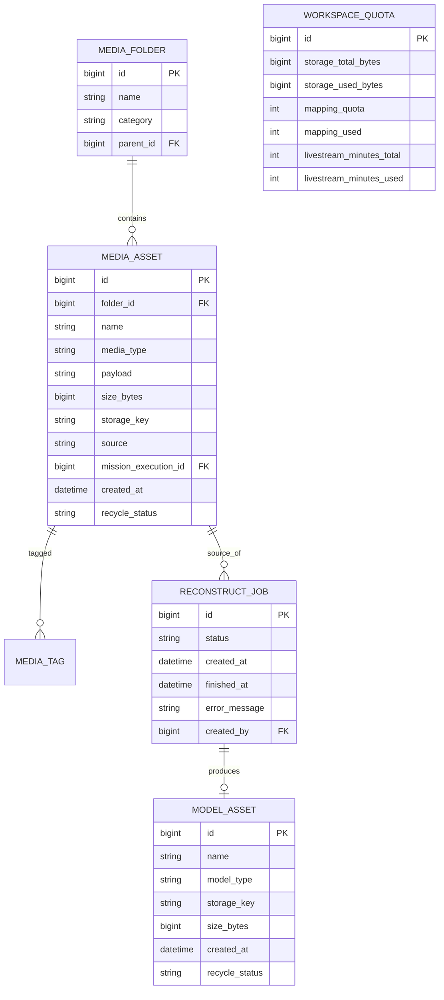

# E-R · 资源库（Media Asset）

## 限界上下文

媒体/模型/设计文件与回收站；模型重建异步任务；存储用量。顶栏「数据管理」采用 **方案 A：等同资源库视图**。

## 核心聚合

- **MediaFolder / MediaAsset 聚合**  
- **ModelAsset 聚合**  
- **ReconstructJob 聚合**  
- **Quota 聚合**（平台级用量，可放 Analytics，此处保留写入方）  

## 实体要点

| 实体 | 说明 | 聚合根 |
|------|------|--------|
| MediaAsset | 照片/视频/压缩包 | 是 |
| MediaFolder | 文件夹（巡检批次、直播回放等） | 是 |
| ModelAsset | 2D/3D/点云等 | 是 |
| ReconstructJob | 重建任务 | 是 |
| WorkspaceQuota | 配额用量 | 是 |

### MediaAsset.source

`upload` / `livestream_record` / `mission_return` / `import`

### recycle_status

`normal` / `in_trash` / `deleted`

## 领域事件

| 事件 | 订阅方 |
|------|--------|
| MediaUploaded | Analytics、Quota |
| MediaTrashed / Restored | Quota |
| ReconstructJobCompleted | ModelAsset、Analytics |
| QuotaChanged | Analytics 看板 |
