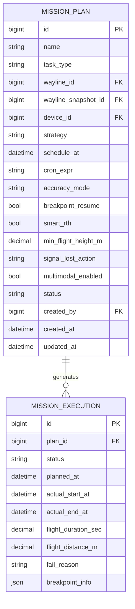

# E-R · 任务计划（Mission）

## 限界上下文

将航线、设备与时间/安全策略绑定为可执行计划，管理状态机与执行记录。

## 核心聚合

- **MissionPlan 聚合**：计划定义与状态  
- **MissionExecution 聚合**：单次执行实例（循环任务会有多条）  

## 状态机（与 PRD 对齐）

`draft` → `pending` → `running` → `completed` | `failed` | `ended`  
`pending` ↔ `paused`  
`partial` →（断点续飞）新 `pending` 执行

## 实体字段要点

### MissionPlan

| 字段 | 说明 |
|------|------|
| task_type | normal / wayline / manual |
| strategy | immediate / once / recurring / continuous |
| accuracy_mode | rtk / gnss |
| signal_lost_action | rth / continue |
| wayline_snapshot_id | 创建时航线副本，避免库内修改影响已建计划 |

### MissionExecution

| 字段 | 说明 |
|------|------|
| status | 与计划状态对应的执行态 |
| breakpoint_info | 断点续飞坐标/航点索引 |

## 领域事件

| 事件 | 触发 | 订阅方 |
|------|------|--------|
| MissionPlanCreated | 新建 | Analytics |
| MissionStarted | 开始执行 | Device（作业中） |
| MissionCompleted | 成功结束 | Device、Media、Analytics |
| MissionFailed | 失败 | Device、Analytics |
| MissionPaused / Resumed | 人工操作 | Analytics |
