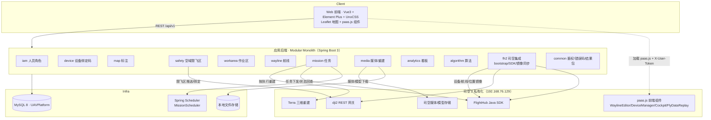
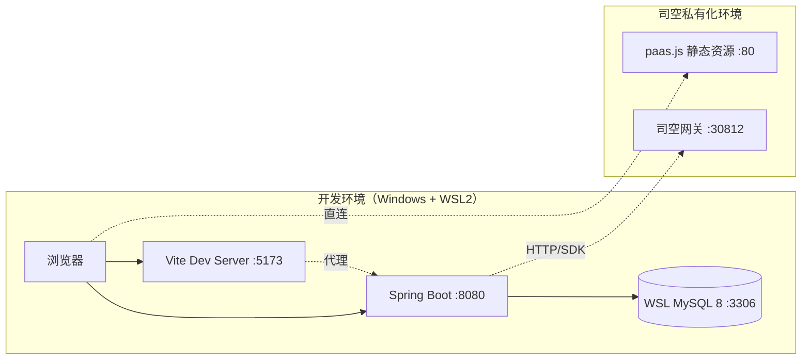
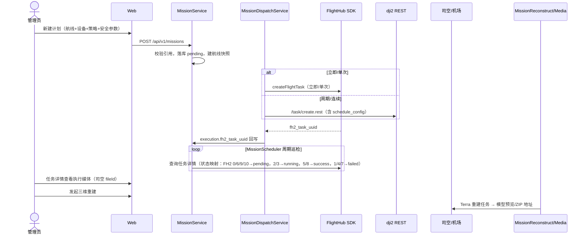
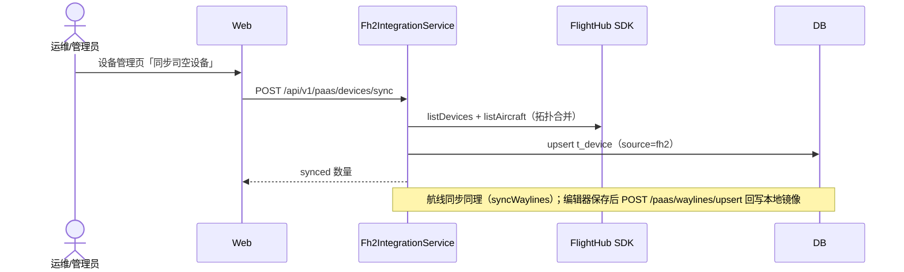
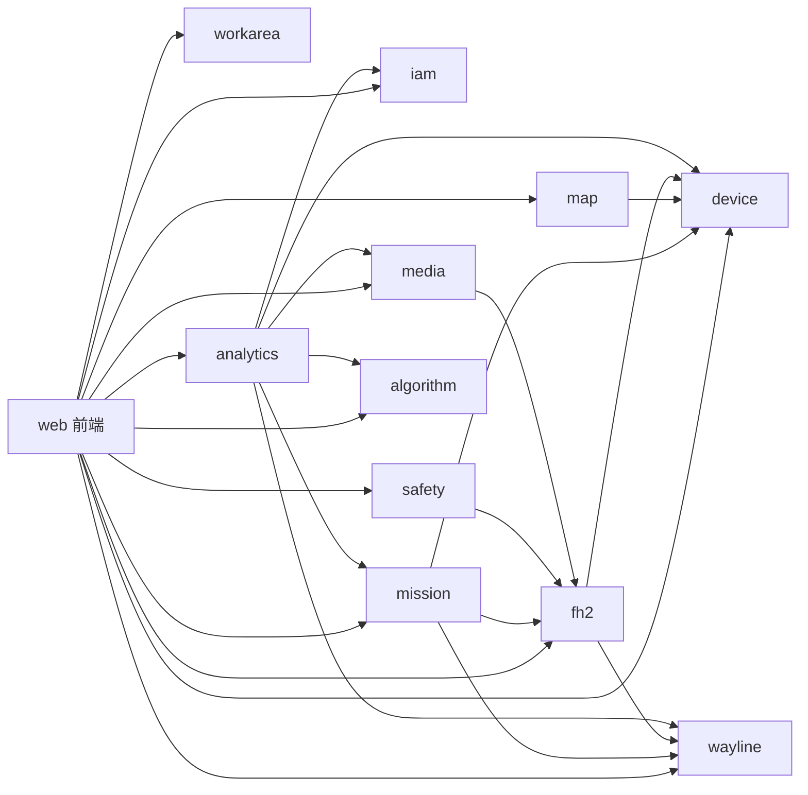

# 概要设计文档 · UAVPlatform 单作业空间无人机云端平台

| 文档版本 | 修改日期 | 修改人 | 修改内容 |
|----------|----------|--------|----------|
| V1.0 | 2026-07-21 | Auto | 初稿：基于 PRD V0.1 与 Element Plus 深色原型 |
| V2.0 | 2026-08-24 | Auto | **按已实现代码重构**：项目定名 UAVPlatform；新增 FH2 司空集成、空域安全（safety/workarea）上下文；技术选型落定（MySQL 8 + MyBatis-Plus + Leaflet + paas.js/DJI 组件）；任务下发/三维重建/驾驶舱/飞行回放流程落地；功能清单补 U-081～U-091 |

**上游**：`docs/02-product/prd/PRD-司空单项目作业平台.md`、`docs/02-product/prototype/index.html`
**E-R 明细**：`docs/03-design/er/`（基线 v1.0；FH2/空域增量见第 4.4 节与 `docs/03-design/database/alter-*.sql`、`ddl-fh2-v1.1.sql`）
**功能点编号**：见第 8 章及 `feature-uid-list.md`（下游统一编号源）

---

## 1. 概述

### 1.1 项目背景

构建面向固定场地、单一作业主体的 Web 云端无人机作业平台（**UAVPlatform**）。相对司空多项目模型，本系统以**单作业空间**为唯一业务容器，覆盖看板、地图标注、空域安全、航线、任务计划、媒体库与三维重建、人员权限与设备管理。

**V2.0 关键决策**：平台与**私有化司空 2（DJI FlightHub 2 / FH2 PaaS）深度集成**——航线编辑、设备管理、驾驶舱直播、飞行回放复用司空前端组件（paas.js）；任务下发、设备/航线同步、限飞区推送、三维重建通过 FlightHub Java SDK 与 dji2 REST API 完成。本平台承担统一门户、业务编排与数据沉淀（镜像 + 扩展）职责。

### 1.2 适用范围

- Web 管理端（主）：Vue 3 SPA
- 与私有化司空 2 的双向集成（本平台 ↔ 司空：下发任务/推送安全区；司空 → 本平台：镜像设备/航线/媒体/模型）
- 不含：多组织多项目、正式对外 OpenAPI SLA、完整 Pilot 产品规格

### 1.3 术语与缩写

| 术语 | 说明 |
|------|------|
| 作业空间 Workspace | 平台唯一租户级业务容器（本期单实例，workspace_id=1） |
| BC | Bounded Context，限界上下文 |
| U-ID | 功能点唯一编号，下游详设/开发计划复用 |
| FH2 / 司空 | DJI FlightHub 2 私有化部署实例（192.168.76.129） |
| paas.js | 司空前端组件库（WaylineEditor / DeviceManager / Cockpit / FlyDataReplay） |
| dji2 REST | 司空侧 openapi HTTP 网关（`/task/create.rest` 等） |
| KMZ/WPML | 航线文件格式 |
| binding_uuid | 司空工作空间绑定标识 |
| Terra | 司空三维重建引擎，产出倾斜摄影模型 |

---

## 2. 总体架构

### 2.1 架构图（V2.0 · 已实现）

**模块化单体（Modular Monolith）**：一个可部署后端 `uavplatform-backend`（Spring Boot 3，包名 `com.uavplatform.*`），内部按限界上下文分包；对外通过 FH2 SDK Client / dji2 REST Client 与司空集成。

### 2.2 架构说明

| 层 | 职责（已实现） |
|----|------|
| 体验层 | 首页看板、地图标注、空域安全、航线库（内嵌 WaylineEditor）、任务、驾驶舱、回放、媒体库、人员/角色、设备（内嵌 DeviceManager）、个人中心；按权限码渲染菜单 |
| 应用层 | Controller + Service + MyBatis-Plus Mapper；`PermissionChecker` 权限校验；`@Transactional` 事务边界 |
| 集成层 | `fh2` 包：`Fh2RuntimeConfigHolder`（yml + t_fh2_config 双源配置）、`ReflectiveFh2SdkClient`（反射调用 FlightHub Java SDK）、`Dji2TaskClient`/`Dji2SafetyClient`（dji2 REST） |
| 基础设施 | MySQL 8、本地文件存储（媒体）、JWT + 内存 TokenBlacklist、Spring Scheduler |

**依赖原则**：
- 业务 BC 之间以 ID 引用 + 同步查询为主（单体内部直调 Mapper）
- `fh2` 为唯一司空出入口；mission/safety/media 经 fh2 提供的 SDK Client / REST Client 访问司空
- analytics 只读查询业务表

### 2.3 部署架构（已实现形态）

- 开发期：Windows 前端 + WSL 后端/MySQL（`run-backend-wsl.sh`）；docker-compose 可选
- 司空环境跨网段访问，通过 `t_fh2_config` 动态切换地址（`patch-fh2-front-host.sql`）

---

## 3. 技术选型（已落定）

| 领域 | 选型（实际采用） | 版本 | 说明 |
|------|------------------|------|------|
| 后端框架 | Java Spring Boot | 3.x | 模块化单体，包 `com.uavplatform.*` |
| ORM | MyBatis-Plus | 3.5.x | LambdaQueryWrapper；显式置空策略 |
| 前端框架 | Vue 3 + Element Plus + UnoCSS + Vite | 最新稳定 | 深色主题；vue-router SPA |
| 前端国际化 | vue-i18n | 9.x | zh-CN / en-US |
| 图表 | ECharts（按需注册） | 5.x | 环图/折线/柱状 |
| 地图 | Leaflet + 本地瓦片（tiles_tianjin，XYZ） | 1.9 | 自研地图页/首页看板；司空组件用其内置地图 |
| 数据库 | MySQL 8（库名 UAVPlatform） | 8.x | JSON 字段存 GeoJSON |
| 鉴权 | JWT（jjwt）+ 内存 TokenBlacklist | — | 登出/删人即时失效；无 Redis |
| 对象存储 | 本地磁盘（媒体文件） | — | MinIO/OSS 预留接口形态（upload-credential/download-url） |
| 任务调度 | Spring `@Scheduled`（MissionScheduler） | — | 定时/周期计划触发 |
| 司空前端组件 | paas.js（WaylineEditor / DeviceManager-v2 / Cockpit / FlyDataReplay） | 私有化 | 动态 script/css 加载 + 全局容器管理 |
| 司空后端集成 | FlightHub Java SDK（反射封装）+ dji2 REST | 2026-07 构建 | `ReflectiveFh2SdkClient` 免编译依赖 |
| 网关 | 开发期 Vite proxy；无独立网关 | — | 生产可加 Nginx |
| 测试 | Vitest（前端）+ JUnit（后端） | — | `*.test.ts` / `InitTest.java` |

---

## 4. E-R 图与领域建模

### 4.1 限界上下文总览（V2.0：11 个 BC）

`IAM`、`Device`、`Map`、`Safety`（空域限飞区）、`WorkArea`（作业区）、`Wayline`、`Mission`、`Media`、`Analytics`、`Algorithm`、`FH2 Integration`（司空集成）。
关系图见：[`../er/er-context-map.md`](../er/er-context-map.md)（v1.0 基线，新增上下文见 4.4）

### 4.2 领域汇总

| 领域（上下文） | 核心聚合 | E-R 图文件 |
|----------------|----------|------------|
| 身份与权限 | User, Role, Permission | [`er-iam.md`](../er/er-iam.md) |
| 机队设备 | Device, DeviceStatus, BindCode, IssueReport | [`er-device.md`](../er/er-device.md) |
| 地图标注 | Annotation, AnnotationFolder, SyncJob | [`er-map.md`](../er/er-map.md) |
| 空域安全 | SafetyArea, SafetyDeviceSync | 本版新增（见 4.4） |
| 作业区 | WorkArea | 本版新增（见 4.4） |
| 航线 | Wayline, WaylineFolder | [`er-wayline.md`](../er/er-wayline.md) |
| 任务计划 | MissionPlan, MissionExecution | [`er-mission.md`](../er/er-mission.md) |
| 资源库 | MediaAsset, MediaFolder, ModelAsset, ReconstructJob, Quota | [`er-media.md`](../er/er-media.md) |
| 看板分析 | DashboardSnapshot, DailyStats | [`er-analytics.md`](../er/er-analytics.md) |
| 算法 | Algorithm, AlgorithmAlarm | [`er-algorithm.md`](../er/er-algorithm.md) |
| 司空集成 | Fh2Config（+ Device/Wayline 上的 fh2_* 字段） | 本版新增（见 4.4） |

汇总表：[`er-summary.md`](../er/er-summary.md)

### 4.3 设计要点

1. **无 Project 实体**；所有业务归属 Workspace（workspace_id=1）。
2. **航线快照**：创建计划时复制航线内容至 `t_wayline_snapshot`；执行记录另存 `fh2_task_uuid` 关联司空任务。
3. **双源数据模型**：`t_device.source`、`t_wayline.source` 取值 `local/fh2`；司空侧实体以 `fh2_wayline_uuid`（唯一键）/ `gateway_sn` 回写镜像。
4. **限飞区双态**：本地 `t_safety_area`（GeoJSON）+ 司空侧 `fh2_flight_area_id`；`t_safety_device_sync` 记录每台设备同步状态机。
5. **重建任务三态关联**：`t_reconstruct_job` 同时携带本地 `mission_plan_id/mission_execution_id` 与司空 `fh2_task_uuid/fh2_model_id/fh2_task_folder_id`。

### 4.4 FH2 / 空域增量表（相对 er v1.0 基线）

| 表/字段 | 类型 | DDL |
|---------|------|-----|
| `t_fh2_config`（新表） | 司空接入配置（enabled/front_host/server_host/gateway_base/wss_url/user_token/binding_uuid/sdk_*/wayline_sdk_*/device_sdk_*/extra_header_*） | `ddl-fh2-v1.1.sql` |
| `t_workspace` + `fh2_binding_uuid`、`fh2_synced_at` | 工作空间绑定司空 | 同上 |
| `t_device` + `gateway_sn`、`fh2_device_model_key`、`source`、`fh2_synced_at` | 设备镜像 | 同上 |
| `t_wayline` + `fh2_wayline_uuid`(uk)、`source` | 航线镜像 | 同上 |
| `t_mission_execution` + `fh2_task_uuid` | 执行关联司空任务（FlyDataReplay.taskId） | `alter-mission-execution-fh2-task.sql` |
| `t_mission_plan` + `schedule_config`(JSON) | 策略调度明细（日期/时段/频率/电量） | `alter-mission-schedule-config.sql` |
| `t_reconstruct_job` + mission/fh2 关联列 + `preview_url`/`model_url`(TEXT) | 任务级重建 | `alter-reconstruct-job-mission.sql` 等 |
| `t_safety_area`（新表）+ `fh2_flight_area_id` | 限飞区 | `alter-safety-area.sql` 等 |
| `t_safety_device_sync`（新表） | 限飞区设备同步状态 | 同上 |
| `t_work_area`（新表） | 作业区（含 min/max_altitude） | `alter-work-area.sql` |
| `t_user` + `email` | 个人信息邮箱 | `alter-user-email.sql` |

---

## 5. 关键流程（V2.0 · 已实现）

### 5.1 核心业务时序 · 任务下发到回传（经司空）

### 5.2 司空镜像同步

### 5.3 空域安全同步

管理员在空域安全页绘制限飞区（多边形/圆形）→ `POST /api/v1/safety/areas` 落库 `pending` → 「同步到设备」`POST /api/v1/safety/sync` → `Dji2SafetyClient` 推送司空飞行安全区 API → 回写 `fh2_flight_area_id` 与 `t_safety_device_sync`（wait_sync→synchronizing→synchronized/fail）。作业区仅本地存储，不推送。

### 5.4 前端司空组件装载

`GET /api/v1/paas/bootstrap` 下发 paas.js 配置（frontHost/serverHost/gatewayBase/wssUrl/userToken/bindingUuid + 各组件 css/js 路径）→ 前端 `usePaasBootstrap` 动态加载 paas.js → 按页面装载组件：
- 航线库：WaylineEditor（创建/编辑，保存后 upsert 本地镜像）
- 设备管理：UranusDeviceManagerApp（设备列表/调试）
- 驾驶舱：loadCockpit（gateway_sn + drone_sn 实时画面，共享 `#map-app-global` 地图容器）
- 飞行回放：FlyDataReplay（taskId = execution.fh2_task_uuid）

### 5.5 异常流程

| 场景 | 处理（已实现） |
|------|------|
| 司空 SDK 未初始化 | `/paas/sdk/status` 暴露 initError；下发任务报 MISSION_REMOTE_ERROR，`/paas/sdk/reload` 可重载 |
| 任务详情 404 | SDK 侧详情缺失时按司空 API 版本回退（多版本字段探测） |
| 周期任务未配 route-api-base/userToken | 创建即报错提示配置 |
| 设备离线时下发 | 司空侧返回失败，execution 置 failed 并保留错误信息 |
| 限飞区推送失败 | 单台失败不回滚整单，sync_status=fail + sync_msg |
| 重建地址超长 | preview_url/model_url 已扩为 TEXT |
| 看板统计延迟 | 首页展示轮询数据；无独立缓存层 |

---

## 6. 模块划分

### 6.1 模块总览（后端包 ↔ 职责）

| 后端包（com.uavplatform.*） | 说明 | 核心职责 | 关键接口 |
|----------|------|----------|----------|
| iam | 身份权限 | 登录/JWT/登出黑名单、人员 CRUD、角色权限、邮箱/密码维护 | `/api/v1/auth/**`、`/members/**`、`/roles/**` |
| device | 设备 | 设备分页、绑定码、现场绑定、定损反馈 | `/api/v1/devices**`、`/bind-codes/**`、`/device-issues/**` |
| map | 地图标注 | 标注 CRUD、文件夹、同步任务、Tab 元数据 | `/api/v1/annotations**`、`/annotation-folders/**`、`/map/tabs/meta` |
| safety | 空域安全 | 限飞区 CRUD + 推送司空 + 设备同步状态 | `/api/v1/safety/**` |
| workarea | 作业区 | 作业区 CRUD（本地） | `/api/v1/work-areas/**` |
| wayline | 航线 | 文件夹、航线 CRUD/导入导出、按 uuid 删除 | `/api/v1/waylines**`、`/wayline-folders/**` |
| mission | 任务 | 计划 CRUD/动作、调度、司空下发、执行媒体、任务级重建 | `/api/v1/missions/**` |
| media | 资源 | 媒体上传/下载、文件夹、配额、模型、回收站、重建任务 | `/api/v1/library/**`、`/reconstruct-jobs/**` |
| analytics | 看板 | summary/flight-stats/mission-stats 聚合查询 | `/api/v1/dashboard/**` |
| algorithm | 算法 | 算法列表/能力/启停、AI 告警 | `/api/v1/algorithms/**`、`/algorithm-alarms/**` |
| fh2 | 司空集成 | bootstrap、SDK 状态/重载、设备/航线镜像同步、实时位置、航线 upsert | `/api/v1/paas/**` |
| common | 公共 | ApiResult/PageResult、JWT、PermissionChecker、AuthInterceptor、TokenBlacklist、全局异常 | — |
| config | 配置 | WSL MySQL Host 环境后处理 | — |

### 6.2 前端模块（frontend/src）

| 目录 | 职责 |
|------|------|
| views/ | 16 个路由页面（见 feature-uid-list 映射表） |
| components/ | WaylineEditorPane（编辑器容器）、WaylinePreviewPane、ModelPreviewDialog（模型预览） |
| composables/ | usePaasBootstrap（paas.js 装载与鉴权配置） |
| api/ | 13 个 API 模块（auth/iam/dashboard/device/map/mission/wayline/library/safety/workArea/algorithm/paas/http） |
| utils/ | loadScript（动态 SDK 加载）、sdkContainers（FH2 全局容器/地图上下文管理）、annotationStorage、noflyZoneStorage、workAreaStorage、waylineNameSync |
| i18n/ | zh-CN / en-US 语言包 |

---

## 7. 模块依赖关系

### 7.1 依赖图（后端）

### 7.2 依赖说明

- **mission → wayline/device**：同步校验 + 快照；**mission → fh2**：下发/状态回查/重建
- **safety → fh2**：限飞区经 `Dji2SafetyClient` 推送司空
- **fh2 → device/wayline**：镜像同步回写本地库（upsert）
- **analytics → ***：只读查询
- 禁止反向：device/wayline 不依赖 mission

---

## 8. 功能清单（U-ID）

完整表见同目录 [`feature-uid-list.md`](./feature-uid-list.md)（V2.0，含实现状态列）。V2.0 新增摘要：

| U-ID | 功能名称 | 模块 | PRD | 优先级 |
|------|----------|------|-----|--------|
| U-081 | 空域限飞区管理 | safety | F-M10 | P0 |
| U-082 | 作业区管理 | workarea | F-M10 | P0 |
| U-083 | 司空集成通道 | fh2 | F-M11 | P0 |
| U-084 | 驾驶舱 | web+fh2 | F-M11 | P0 |
| U-085 | 飞行回放 | web+fh2 | F-M11 | P1 |
| U-086 | 任务级三维重建 | mission+media | F-M5/M6 | P1 |
| U-087 | 个人信息中心 | iam | F-M1 | P1 |
| U-088 | 司空设备/航线镜像同步 | fh2 | F-M11 | P1 |
| U-089 | 在飞飞行器实时位置 | fh2+web | F-M2 | P1 |
| U-090 | 界面国际化 | web | 全局 | P2 |
| U-091 | 执行记录媒体管理 | mission+media | F-M5 | P1 |

> **U-ID 为下游统一编号源，禁止并行另造编号体系。**

---

## 9. 非功能要求

| 类别 | 要求（V2.0 校准） |
|------|------|
| 性能 | 看板接口 P95 < 2s；列表默认 50/页；首页在飞位置轮询节流 |
| 安全 | JWT + 登出/删人黑名单；RBAC 权限码；司空 userToken 仅经 bootstrap 下发给已鉴权前端 |
| 可用性 | 司空 SDK 状态可观测可重载；重建/回放失败可重试；表单失败保留输入 |
| 兼容 | Chrome 近两版；坐标系 WGS84；XYZ 瓦片本地化 |
| 可维护 | 统一 ApiResult/错误码/requestId；`com.uavplatform.fh2` debug 日志开关 |
| 扩展 | 模块化单体可拆 fh2-worker / media-worker；t_fh2_config 支持运行时切换司空地址 |

---

## 10. 风险点（V2.0 复核）

| 风险编号 | 风险描述 | 影响范围 | 概率 | 影响 | 应对措施（现状） |
|----------|----------|----------|------|------|----------|
| R-001 | 司空 API 版本差异（SDK 反射调用、任务详情字段漂移） | mission/fh2 | 高 | 高 | ReflectiveFh2SdkClient 隔离；详情接口多版本回退探测 |
| R-002 | 航线格式兼容（KMZ/WPML） | wayline | 中 | 中 | WaylineEditor 为主编辑通道；本地导入导出兜底 |
| R-003 | 看板实时性与统计口径 | analytics | 中 | 中 | 首页轮询；口径以本地库为准 |
| R-004 | 媒体体量与存储成本 | media | 中 | 中 | 配额接口已备；生命周期策略后置 |
| R-005 | 单空间假设未来多租户 | 全局 | 低 | 高 | workspace_id 预留 |
| R-006 | 内存 TokenBlacklist 重启失效 | iam | 中 | 低 | 重启后 JWT 自然过期兜底；可演进 Redis |
| R-007 | 司空前端组件全局容器冲突（地图/主题串染） | web | 高 | 中 | sdkContainers 统一销毁/重建；切页卸载清理 |

---

## 11. 下游衔接

| 下一步 | 输入 |
|--------|------|
| 详细设计 | 本概要 + U-ID（V2.0）+ 增量 DDL |
| 数据库设计 | `docs/03-design/er/` + `docs/03-design/database/`（v1.0 + fh2 v1.1 + alter 系列） |
| 测试 | `docs/05-test/`（用例需按 U-081+ 增补） |
