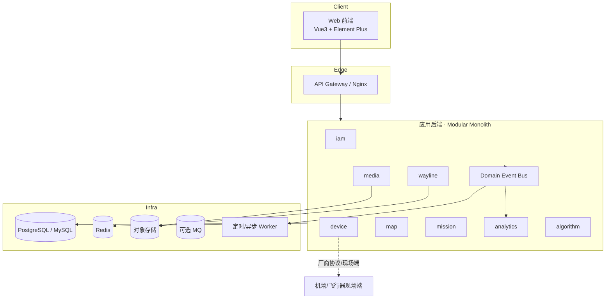
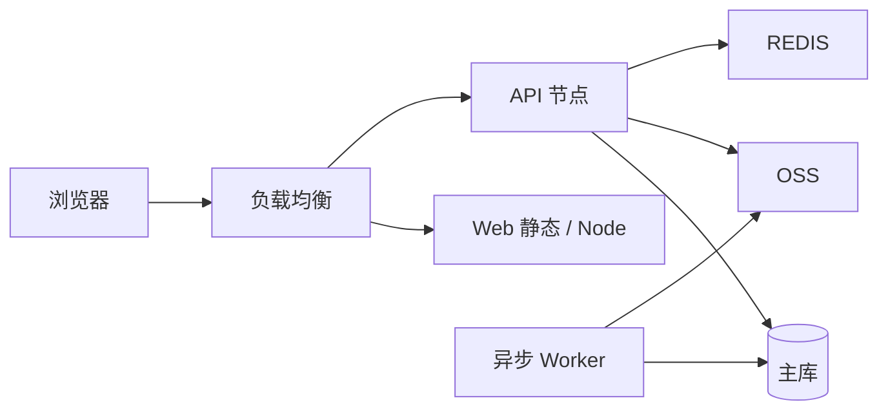
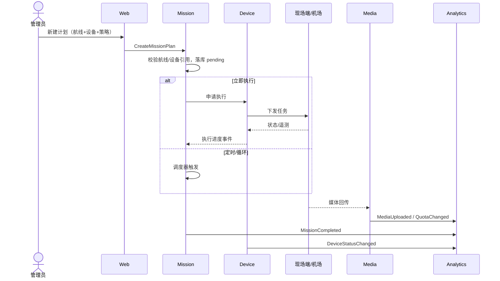
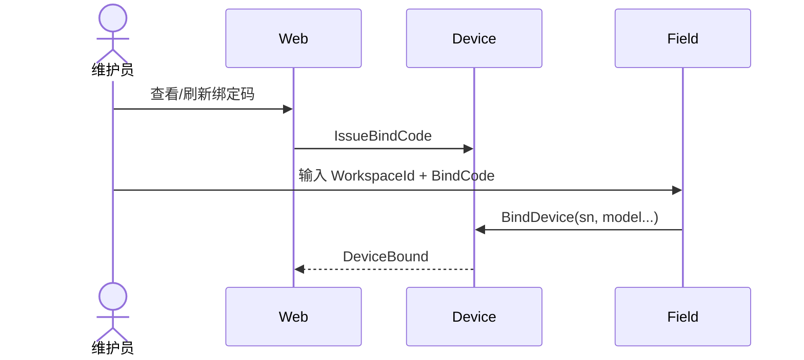
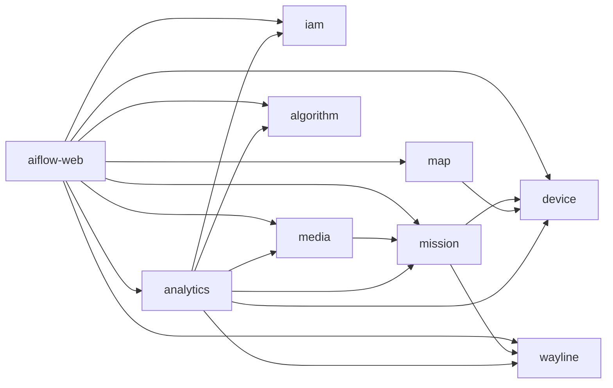

# 概要设计文档 · AiFlow 单作业空间无人机云端平台

| 文档版本 | 修改日期 | 修改人 | 修改内容 |
|----------|----------|--------|----------|
| V1.0 | 2026-07-21 | Auto | 初稿：基于 PRD V0.1 与 Element Plus 深色原型 |

**上游**：`docs/02-product/prd/PRD-司空单项目作业平台.md`、`docs/02-product/prototype/index.html`  
**E-R 明细**：`docs/03-design/er/`  
**功能点编号**：见第 8 章及 `feature-uid-list.md`（下游统一编号源）

---

## 1. 概述

### 1.1 项目背景

构建面向固定场地、单一作业主体的 Web 云端无人机作业平台。相对司空多项目模型，本系统以**单作业空间**为唯一业务容器，覆盖看板、地图标注、航线、任务计划、资源库、人员权限与设备管理，并为算法与自动化预留扩展。

### 1.2 适用范围

- Web 管理端（主）  
- 与现场端/机场的绑定与标注同步（边界能力，协议细节在详设）  
- 不含：多组织多项目、正式对外 OpenAPI SLA、完整 Pilot 产品规格  

### 1.3 术语与缩写

| 术语 | 说明 |
|------|------|
| 作业空间 Workspace | 平台唯一租户级业务容器（本期单实例） |
| BC | Bounded Context，限界上下文 |
| U-ID | 功能点唯一编号，下游详设/开发计划复用 |
| KMZ/WPML | 航线文件格式 |
| 读模型 | Analytics 中仅供查询的投影数据 |

---

## 2. 总体架构

### 2.1 架构图

推荐 **模块化单体（Modular Monolith）**：一个可部署后端，内部按限界上下文分包；异步用消息/本地事件总线。后续可将 Device 对接、Media 转码、重建任务拆为独立服务。

### 2.2 架构说明

| 层 | 职责 |
|----|------|
| 体验层 | 看板、作业台、管理页；鉴权后按权限渲染 |
| 网关层 | TLS、路由、限流、静态资源 |
| 应用层 | 用例服务、DTO、权限注解、事务边界 |
| 领域层 | 聚合、领域服务、领域事件（按 BC 分包） |
| 基础设施 | ORM、OSS、Redis 会话、事件发布、厂商 ACL |

**依赖原则**：Analytics 只订阅事件；业务 BC 之间以 ID 引用 + 事件为主，禁止循环写库。

### 2.3 部署架构（初稿）

- 开发期：单机 Docker Compose（API + DB + Redis + MinIO）  
- 生产：API 无状态水平扩展；媒体走 OSS；重建/同步任务走 Worker  

---

## 3. 技术选型

| 领域 | 选型方案 | 版本建议 | 选型理由 |
|------|----------|----------|----------|
| 后端框架 | Java Spring Boot | 3.x | 与团队 Java 规范/阿里巴巴手册衔接；生态成熟 |
| 前端框架 | Vue 3 + Element Plus | 最新稳定 | 原型已用 Element Plus 深色；中后台效率高 |
| 数据库 | PostgreSQL（优先）或 MySQL 8 | — | JSON/几何扩展友好（PG）；若团队标配 MySQL 亦可 |
| 缓存 | Redis | 7.x | 会话、绑定码、看板热点、分布式锁 |
| 消息/事件 | Spring 应用内事件 → 可选 RocketMQ/RabbitMQ | — | 单体先内聚，扩展时外置 |
| 对象存储 | MinIO / 云 OSS | — | 媒体与 KMZ |
| 地图 | 商业或开源底图 SDK（详设选定） | — | WGS84；2D/3D |
| 网关 | Nginx / Spring Cloud Gateway | — | 反代与静态 |
| CI/CD | GitLab CI / GitHub Actions | — | 构建镜像与质量门禁 |
| 监控日志 | Micrometer + 集中日志 | — | 登录/绑设备/下发任务链路 |

> 若现有技术栈已定，以现有栈为准，本章可修订为遵奉说明。

---

## 4. E-R 图与领域建模

### 4.1 限界上下文总览

八个 BC：`IAM`、`Device`、`Map`、`Wayline`、`Mission`、`Media`、`Analytics`、`Algorithm`。  
关系图见：[`../er/er-context-map.md`](../er/er-context-map.md)

### 4.2 领域汇总

| 领域（上下文） | 核心聚合 | E-R 图文件 |
|----------------|----------|------------|
| 身份与权限 | User, Role | [`er-iam.md`](../er/er-iam.md) |
| 机队设备 | Device, BindCode, IssueReport | [`er-device.md`](../er/er-device.md) |
| 地图标注 | Annotation, SyncJob | [`er-map.md`](../er/er-map.md) |
| 航线 | Wayline, Folder | [`er-wayline.md`](../er/er-wayline.md) |
| 任务计划 | MissionPlan, MissionExecution | [`er-mission.md`](../er/er-mission.md) |
| 资源库 | MediaAsset, Model, ReconstructJob, Quota | [`er-media.md`](../er/er-media.md) |
| 看板分析 | DashboardSnapshot, DailyStats | [`er-analytics.md`](../er/er-analytics.md) |
| 算法 | Algorithm, Alarm | [`er-algorithm.md`](../er/er-algorithm.md) |

汇总表：[`er-summary.md`](../er/er-summary.md)

### 4.3 设计要点

1. **无 Project 实体**；设备/人员/航线/标注均归属 Workspace（可单行配置表）。  
2. **航线快照**：创建任务计划时复制航线内容，避免库内修改污染已下发计划。  
3. **Analytics 读模型**：看板不直连扫业务大表做复杂聚合（可先同步查，演进为投影）。  

---

## 5. 关键流程

### 5.1 核心业务时序 · 任务下发到回传

### 5.2 设备绑定

### 5.3 标注设备同步

管理员在地图点击「设备同步」→ Map 创建 SyncJob → Device ACL 推送 → 更新 Annotation.sync_status。

### 5.4 异常流程

| 场景 | 处理 |
|------|------|
| 任务执行中删除航线 | 拒绝删除或仅允许归档；校验执行中引用 |
| 设备离线时下发 | 计划保持 pending/失败可配；提示用户 |
| 媒体上传失败 | 可重试；任务执行仍可完成，回传状态单独展示 |
| 绑定码过期 | 刷新绑定码；现场端明确错误码 |
| 看板统计延迟 | 显示「更新于」时间；允许手动刷新 |

---

## 6. 模块划分

### 6.1 模块总览

| 模块名称 | 说明 | 核心职责 |
|----------|------|----------|
| aiflow-web | 前端 | 页面、权限指令、地图 SDK 集成 |
| aiflow-gateway | 可选网关 | 路由鉴权 |
| aiflow-iam | 身份权限 | 登录、人员、角色权限 |
| aiflow-device | 设备 | 绑定、状态、定损、同步下发 |
| aiflow-map | 地图 | 标注 CRUD、同步任务 |
| aiflow-wayline | 航线 | 航线库、导入导出 |
| aiflow-mission | 任务 | 计划、调度、状态机 |
| aiflow-media | 资源 | 媒体/模型/重建/配额 |
| aiflow-analytics | 看板 | 指标聚合查询 |
| aiflow-algorithm | 算法 | 算法与告警（P2） |
| aiflow-common | 公共 | 鉴权注解、错误码、事件基础设施 |

### 6.2 模块详情（摘要）

#### 6.2.1 aiflow-iam

- **职责**：认证、会话、RBAC  
- **关键接口**：`POST /api/auth/login`、`/api/members/**`、`/api/roles/**`  

#### 6.2.2 aiflow-device

- **职责**：设备台账、绑定码、状态、定损、接收 Map 同步  
- **关键接口**：`/api/devices/**`、`/api/bind-codes/**`、现场端绑定回调  

#### 6.2.3 aiflow-map / wayline / mission

- **作业台主路径**：标注 → 航线 → 计划  
- **关键接口**：`/api/annotations/**`、`/api/waylines/**`、`/api/missions/**`  

#### 6.2.4 aiflow-media

- **职责**：文件元数据、OSS 直传凭证、回收站、重建任务  
- **关键接口**：`/api/library/**`、`/api/reconstruct-jobs/**`  

#### 6.2.5 aiflow-analytics

- **职责**：看板聚合查询  
- **关键接口**：`GET /api/dashboard/summary`、`/api/dashboard/flight-stats`  

---

## 7. 模块依赖关系

### 7.1 依赖图

### 7.2 依赖说明

- **mission → wayline/device**：同步查询校验 + ID 持久化；运行期事件驱动状态  
- **map → device**：同步下发（异步任务）  
- **analytics → * **：仅事件/只读查询，不写业务库  
- **禁止** device → mission 直接写计划表（通过事件回写执行状态接口）  

---

## 8. 功能清单（U-ID）

完整表见同目录 [`feature-uid-list.md`](./feature-uid-list.md)。摘要：

| U-ID | 功能名称 | 模块 | PRD | 优先级 |
|------|----------|------|-----|--------|
| U-001 | 账号密码登录 | iam | F-M1 | P0 |
| U-002 | 人员添加 | iam | F-M1 | P0 |
| U-003 | 角色权限配置 | iam | F-M1 | P0 |
| U-004 | 人员编辑/删除 | iam | F-M1 | P1 |
| U-010 | 看板资产与设备概览 | analytics | F-M2 | P0 |
| U-011 | 看板数据成果 | analytics | F-M2 | P0 |
| U-012 | 看板飞行数据 | analytics | F-M2 | P0 |
| U-013 | 看板时间筛选与任务/自动化图表 | analytics | F-M2 | P1 |
| U-014 | 看板中央地图 | map/web | F-M2 | P0 |
| U-020 | 标注点线面 CRUD | map | F-M3 | P0 |
| U-021 | 地图量测 | map/web | F-M3 | P0 |
| U-022 | 设备同步标注 | map+device | F-M3 | P0 |
| U-023 | 高程/安全 Tab | map | F-M3 | P1 |
| U-030 | 航线列表与文件夹 | wayline | F-M4 | P0 |
| U-031 | 航线创建编辑 | wayline | F-M4 | P0 |
| U-032 | 航线导入导出 | wayline | F-M4 | P1 |
| U-040 | 新建任务计划 | mission | F-M5 | P0 |
| U-041 | 执行策略与调度 | mission | F-M5 | P0 |
| U-042 | 安全作业参数 | mission | F-M5 | P0 |
| U-043 | 计划状态管理 | mission | F-M5 | P0 |
| U-044 | 多模态识别开关 | mission+algorithm | F-M5 | P1 |
| U-050 | 媒体库管理 | media | F-M6 | P0 |
| U-051 | 模型/设计文件/回收站 | media | F-M6 | P1 |
| U-052 | 模型重建任务 | media | F-M6 | P1 |
| U-053 | 智能搜索/变化检测/全景入口 | media | F-M6 | P2 |
| U-060 | 设备分类列表 | device | F-M7 | P0 |
| U-061 | 设备绑定码 | device | F-M7 | P0 |
| U-062 | 设备定损反馈 | device | F-M7 | P1 |
| U-070 | 算法列表与启停 | algorithm | F-M8 | P2 |
| U-071 | AI 告警记录 | algorithm | F-M8 | P2 |
| U-080 | 数据管理入口（=资源库） | media | F-M9 | P1 |

> **U-ID 为下游 `tkxm-devplan` / `tkxm-detail` 统一编号源，禁止并行另造编号体系。**

---

## 9. 非功能要求

| 类别 | 要求 |
|------|------|
| 性能 | 看板关键接口 P95 &lt; 2s；列表默认 50/页；地图标注量大时分层/聚合 |
| 安全 | 登录会话；RBAC；绑定码有效期；敏感操作审计（P1） |
| 可用性 | 异步任务可查状态；写失败可重试 |
| 兼容 | Chrome 近两版主支持；坐标系 WGS84 |
| 可维护 | 统一错误码；关键链路日志（登录/绑定/下发/上传） |
| 扩展 | 模块化单体可拆 Device Worker / Media Worker |

---

## 10. 风险点

| 风险编号 | 风险描述 | 影响范围 | 概率 | 影响 | 应对措施 |
|----------|----------|----------|------|------|----------|
| R-001 | 现场端/厂商协议不透明 | Device、同步、任务 | 高 | 高 | 早做 ACL 与联调环境；接口版本化 |
| R-002 | 航线格式兼容（KMZ/WPML）差异 | Wayline | 中 | 高 | 先支持航点 + 一种面状；校验器与样例库 |
| R-003 | 看板实时性与统计口径不一致 | Analytics | 中 | 中 | 明确事件驱动口径；展示更新时间 |
| R-004 | 媒体体量导致存储成本 | Media | 中 | 中 | 配额告警、生命周期策略 |
| R-005 | 单空间假设未来要多租户 | 全局 | 低 | 高 | WorkspaceId 预留字段，忌写死全局单表无租户键 |
| R-006 | PRD 待确认项未决 | 范围 | 中 | 中 | 详设前关闭 10.3；默认方案 A、航点优先、直播 P1 |

---

## 11. 下游衔接

| 下一步 | Skill | 输入 |
|--------|-------|------|
| 开发计划（依赖 DAG/波次） | `tkxm-devplan` | 本概要 + U-ID + E-R |
| 数据库设计 | `tkxm-database` | `docs/03-design/er/` |
| 详细设计 | `tkxm-detail` | 本概要 + 选定 U-ID |

**请确认**：限界上下文划分、模块化单体架构、U-ID 清单是否可接受。确认后可进入开发计划或库表设计。
